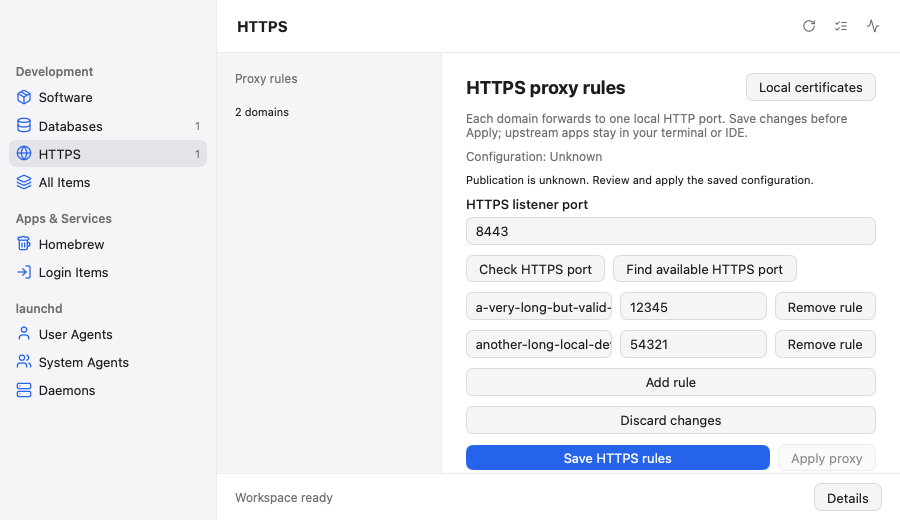

# Devbase

A native macOS app for verified development software, independent database instances, and local HTTPS reverse proxy rules with optional Cloudflare tunnel exposure. It also retains a separate inspector for system services.

## Development

The three main entries are **Software**, **Databases**, and **HTTPS**. Start your application in a terminal or IDE; this app does not start it.



- **Software:** install and manage Node.js, Java, Python, MySQL, PostgreSQL, Redis, and MongoDB. Java installs macOS arm64 JDK distributions from the JetBrains catalog in `~/Library/Java/JavaVirtualMachines`, uses IDEA-style names, and manages existing JDKs in that directory, Python uses the existing uv installation store, and PostgreSQL and Redis use Homebrew core. Archive downloads are checked against upstream hashes and cached under `~/Library/Caches/Devbase/Development`. See the [storage layout](docs/development-runtimes-and-data.md#storage-layout) for installed packages and custom roots. Node.js can use `.node-version`, `.nvmrc`, or `package.json` `engines.node` in any directory without registering it. Set a default and explicitly enable zsh, Bash, or fish integration in a new terminal.
- **Databases:** create independent MySQL, PostgreSQL, Redis, and MongoDB instances with an exact installed version, their own port, and an optional new absolute data location. Different installed PostgreSQL major versions can coexist. External data is retained on Remove; permanent deletion is available only for app-managed data. Create databases/users where supported, back up and restore, and save password-free connection profiles for external clients. Redis uses numbered databases.
- **HTTPS:** edit one table of `Domain → Local port` rules. Each rule forwards to `http://127.0.0.1:<port>`, or to another host you name, through a local HTTPS proxy. Save the full table, then Apply. Domains are always `<name>.devbase.localhost`, which macOS resolves to this Mac without a hosts entry; trusting the local CA is a separate explicit action. The upstream application stays under your control.
- **Cloudflare tunnel (optional):** turn on Tunnel for a rule to expose it publicly. With a saved Cloudflare API token, Save deploys a dedicated `devbase-<name>` Worker + Durable Object for that rule on `*.workers.dev` or a Custom Domain in one of your zones, and removes Workers for rules that no longer tunnel. A background client on this Mac carries requests from the Worker to the rule's upstream. The token is stored in a private file, not in app state.

Java has separate defaults and explicit terminal integration for installed zsh, Bash, and fish. Python requires an installed uv executable; the app can discover it or use an absolute path you select. Its global uv pin does not replace the shell’s `python` command or override a virtual environment. See [runtime and data-location usage](docs/development-runtimes-and-data.md).

The menu bar shows managed database instances, one HTTPS proxy switch, and a Cloudflare tunnel switch once a tunnel is configured. Closing the window leaves them running (the proxy and tunnel are background launchd jobs), and leaves the menu bar icon as the app's only presence: the Dock icon goes away until the window opens again. Quit offers a reviewed keep/stop choice for app-owned resources. System service controls remain under their own source list.

## Installation and permissions

Requires an Apple Silicon Mac running macOS 26 or 27. Only the two latest macOS releases are tested and supported. App release artifacts are described by the build workflow; this source checkout is not itself an installed release. Work that needs root (an HTTPS listener below port 1024 such as 443, system daemons, and Homebrew services registered as root) runs through a privileged helper that the app asks you to install the first time it is needed, with one administrator password; it can also be installed from Settings. Trusting the local CA is a separate step that macOS confirms itself. It never edits the hosts file. Deleting a database instance has a separate data review and confirmation. No product operation should remove an unrelated application process or shared Homebrew keg. The helper only accepts requests from the Devbase build it was installed from, running as the installing user.

## Source and verification

The current product scope is [documented here](docs/product-scope.md). [Usage](docs/development-usage.md), [UI guidance](docs/development-ui.md), and the [acceptance matrix](docs/resources-acceptance.md) describe the new behavior. Verification evidence and missing real-machine checks are in [development-verification](docs/development-verification.md).

```sh
go test ./...
go test -race ./...
go vet ./...
go mod verify
PYTHONDONTWRITEBYTECODE=1 python3 -m unittest discover -s scripts -p 'test_*.py'
python3 scripts/collect-third-party-notices.py --check
go tool mygo build -sign - -skip-notarize
```

Native release acceptance uses `python3 scripts/verify-native-release.py --run` **only on a disposable GitHub-hosted macOS runner**. It requires the exact parent and child tests to execute and pass without skips. Real system trust and Chrome acceptance require a separately signed App on a disposable Mac, as specified in the [acceptance plan](docs/resources-acceptance.md). Neither an ad-hoc build nor private test CA proves that check.

## Contributing

See [CONTRIBUTING.md](CONTRIBUTING.md). The Go/MyGo app, database workers, HTTPS proxy, and macOS service integrations are tested separately. Tests that need real launchd or database binaries must run in an isolated, clean environment.
