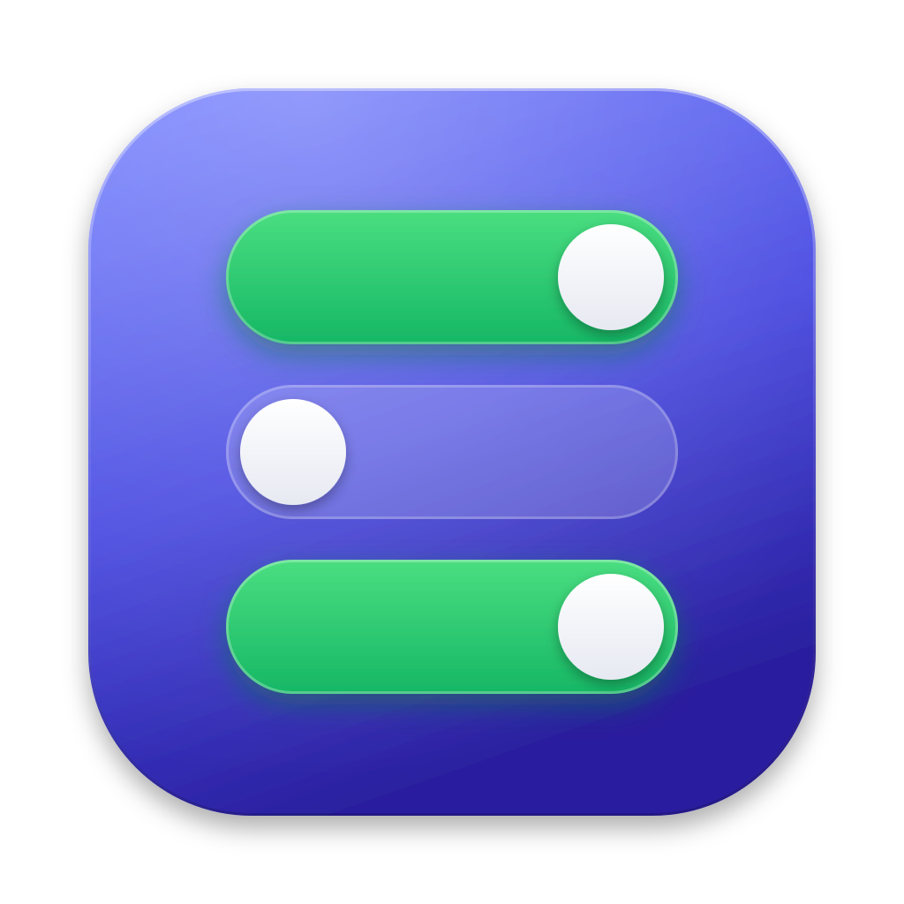
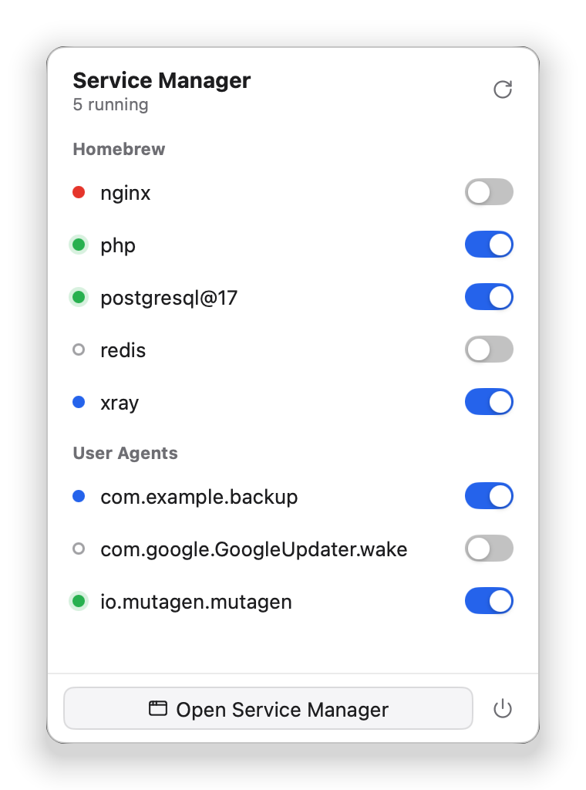
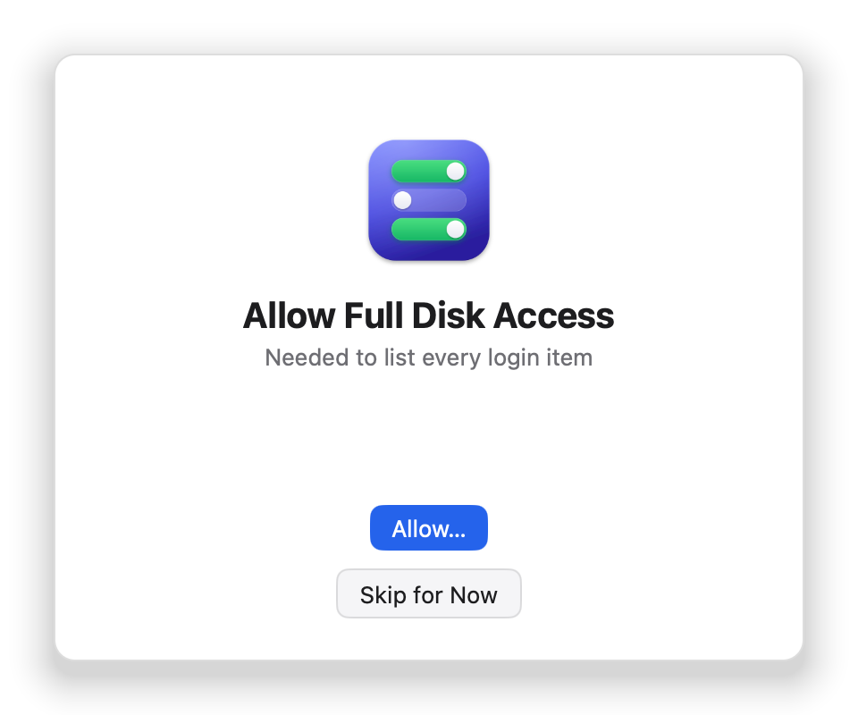
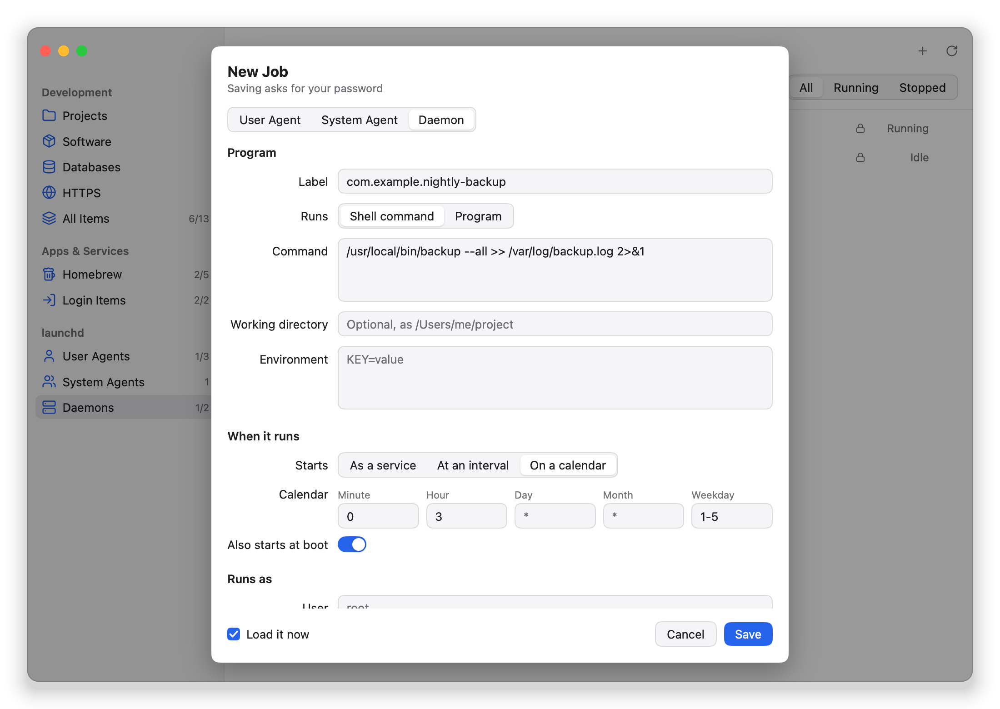

<div align="center">



# macOS Service Manager

Local development environments and launchd services on macOS.


[](https://github.com/egoist/mygo)

[Features](#features) · [Sources](#sources) · [Node.js](#nodejs-versions) · [Jobs](#jobs) · [Permissions](#permissions) · [Install](#install) · [Development](#development)

</div>

<br>

<picture>
  <source media="(prefers-color-scheme: dark)" srcset="docs/images/development/projects-1120x720-dark-true.png">
  
</picture>

## Features

**Development**

- **Projects.** Import a folder, pick runtime versions, services and databases, then start it. Everything is a form; no configuration files to edit. Importing runs no project scripts.
- **Software.** PHP, Node.js, MySQL, PostgreSQL, Redis and MongoDB, each version kept apart. PHP and PostgreSQL come from Homebrew; the rest are verified downloads in app-owned storage. Check and repair installed files.
- **Node.js.** Replaces fnm and nvm: versions come from nodejs.org, each folder runs the version its `.node-version`, `.nvmrc` or `engines.node` names, and everything is managed in the window. See [Node.js versions](#nodejs-versions).
- **Databases.** Private instances with their own port and data. Create databases and users, back up and restore. Permanent deletion needs a path preview and a typed confirmation.
- **HTTPS.** `.test` domains behind a trusted local CA and a loopback reverse proxy, with WebSocket, SSE and uploads. Port 443 uses launchd socket activation.
- **Tasks and diagnostics.** Background installs and database work with cancellation, a history of interrupted work, and a layered check of processes, DNS, CA trust and TLS. Reports export without paths or secrets.
- **Sharing.** Export locked software and database declarations; import them elsewhere with separate instances and credentials.

**Services**

- **One list.** Homebrew services, login items, launch agents and daemons, searchable, filterable, each shown once.
- **Details.** Status, command, files, an autostart switch and live logs.
- **Jobs.** Create, edit and remove launchd jobs without writing a property list.
- **Bulk actions.** ⌘-click or Shift-click to start or stop several items; daemons changed together ask for a password once.
- **Menu bar.** The window can close while the app stays. The panel has a switch per service and project. Quit keeps services or stops managed projects and databases, with a separate choice for the HTTPS proxy.

<p align="center">
  <picture>
    <source media="(prefers-color-scheme: dark)" srcset="docs/images/menu-bar-dark.png">
    
  </picture>
  <picture>
    <source media="(prefers-color-scheme: dark)" srcset="docs/images/welcome-dark.png">
    
  </picture>
</p>

## Sources

| Source | Read from | What you can do |
|---|---|---|
| **Homebrew services** | `brew services`, and launchd for services registered as root | Start, stop, restart; start at login |
| **Login items** | System Settings' database, with Full Disk Access; otherwise System Events, for apps only | Add and remove the apps that open at login. Helpers that apps registered are read-only; System Settings has their switch |
| **User agents** | `~/Library/LaunchAgents` | Load, unload, start, stop, restart; enable, disable; create, edit, remove |
| **System agents** | `/Library/LaunchAgents` | The same; creating, editing and removing take your password |
| **Daemons** | `/Library/LaunchDaemons` | The same; every change takes your password |

## Node.js versions

Everything is in **Software → Node.js**; there is no command line to learn.

- **Releases** come from [nodejs.org](https://nodejs.org/dist/) for Apple Silicon, and each archive is checked against the release's published SHA-256 sums. Set `MSM_NODE_DIST_MIRROR` to an HTTPS mirror to use one instead.
- **Version** lists the newest release of each major, with the long-term support lines named. **Exact version** takes any other release, or a name: `22`, `22.14`, `22.x`, `^20.1`, `>=18 <23`, `lts`, `lts/iron`, `latest`. A name is resolved to one release, and shown in the review, before anything is installed.
- **Default** is set from the installed list; the first version installed becomes the default. Uninstalling a version also removes its global npm packages.
- **Enable in terminal** adds one block to `~/.zshrc`, which only sources a script this app keeps up to date; **Disable in terminal** removes the block. Each new directory then runs the version named by the nearest `.node-version`, `.nvmrc` or `package.json` `engines.node`, else the default. `system` in `.nvmrc` leaves the shell's own Node.js alone, and a version that is not installed is reported in the terminal.
- **Global packages** (`npm install -g`) go to a folder of their own for each version, so the verified installation stays intact. The shell setup starts this app's executable on each `cd`, which takes about a tenth of a second. Turn off fnm and nvm's shell hooks first, or they will fight over `PATH`.

## Jobs

**New Job…** writes and checks the property list, and loads the job on request. Options follow [Launched](https://launched.zerowidth.com/).

<picture>
  <source media="(prefers-color-scheme: dark)" srcset="docs/images/new-job-dark.png">
  
</picture>

| Option | What you can set |
|---|---|
| **Command** | A shell command, run with `/bin/sh -c`, or a program with its arguments |
| **Environment** | Working directory and environment variables |
| **As a service** | Start at login or boot; restart never, after a crash or always; start when a disk mounts, or while a queue directory has files |
| **At an interval** | Every so many seconds |
| **On a calendar** | Minute, hour, day, month and weekday, each a number (`5`), a list (`1,15`), a range (`1-5`) or an interval (`*/10`). An empty field is any value |
| **Logs** | Output and error files. New jobs can log to `<label>.log` in `~/Library/Logs`, or in `/Library/Logs` for a daemon that runs as root |
| **Runs as** | Daemons only: user, group and root directory, which launchd ignores outside the system domain |

Editing keeps what the form cannot show: other keys of the file, `KeepAlive` conditions, and calendars that are not all combinations of their values.

## Permissions

| When you | macOS asks for | How often |
|---|---|---|
| Read any source | Nothing, apart from what login items need below | |
| Change user agents, or Homebrew services that run as you | Nothing | |
| Load, start or stop a system agent | Nothing: it runs in your session | |
| Change a daemon, or a Homebrew service registered as root | Your password | Each time; several daemons together ask once |
| Create, edit or remove a system agent or daemon | Your password | Each time |
| List the helpers in Login Items | Full Disk Access | Once |
| List login items without that access, or add or remove one | Permission to control System Events | Once |
| Read the helpers with `sfltool dumpbtm` instead | An administrator | Every time, and only when you ask |

Before the password, editing a system agent or daemon lists the file keys that will change, and asks nothing if none do. Removing one lists what you lose. Installed software may depend on these jobs, or undo your edit when it updates.

Full Disk Access is optional. The Development workspace never reads login items or requests their permissions at startup; Login Items opens the guide when needed.

> [!WARNING]
> **The Trash is not an undo for system agents and daemons.** Removing one unloads it and
> moves its file to your Trash, but Put Back cannot return it to where launchd reads it.
> To get it back, reinstall the software it came from, or install the file again as root:
>
> ```bash
> sudo install -m 644 -o root -g wheel com.example.job.plist /Library/LaunchDaemons/
> sudo launchctl bootstrap system /Library/LaunchDaemons/com.example.job.plist
> ```

## Install

Build it from source. You need:

- macOS 13 or later on Apple Silicon (M-series, arm64)
- Go 1.27.3 or later
- Apple Silicon Homebrew for PHP, PostgreSQL and the Homebrew service source

Some managed packages need a newer macOS; see the [compatibility notes](docs/development-usage.md). macOS 13 is the binary requirement, not a tested-on-hardware claim.

```bash
git clone https://github.com/tdawn0-0/macOS-service-manager.git
cd macOS-service-manager
go tool mygo build -platform darwin/arm64
```

The app and disk image are in `build/darwin-arm64/`. Intel Macs are not supported. To sign with a Developer ID, see [Packaging](#packaging).

> [!NOTE]
> The `msm-v0.1.0` release on GitHub is the earlier Tauri app, from before this rewrite.

## Keyboard and mouse

| Input | What it does |
|---|---|
| <kbd>⌘</kbd> <kbd>R</kbd> | Refresh |
| <kbd>⌘</kbd> <kbd>F</kbd> | Go to the search |
| <kbd>⌘</kbd>-click, <kbd>⇧</kbd>-click | Choose several items |
| Right click on a row | List everything that can be done to it |

## Development

- [Usage and verification (中文)](docs/development-usage.md)
- [Requirements and plan (中文)](docs/local-dev-platform-plan.md)
- [Interface rules and UI tests (中文)](docs/development-ui.md)

```bash
go tool mygo dev      # run with live reload
go test ./...         # views run without a window; backends run on stubbed commands
go tool mygo build    # a build for this Mac, signed ad hoc
```

GitHub runs `go test ./...` on pull requests and on pushes to any branch. A
release tag runs the tests again, then signs, notarizes and publishes.

### Project layout

```
main.go, menubar.go     the window, and the menu bar icon with its panel
guide.go                the Full Disk Access guide, its window, and the drag overlay
app.go                  the state, and the background work that changes it
view*.go                sidebar, list, details, logs, the editor of launchd's jobs
theme.go, icons.go      the look: colors, status dots, buttons, icons
internal/service        the model every source shares: Item, Action, Provider
internal/brew           Homebrew services
internal/launchd        launch agents and daemons; the plist editor (edit.go), calendars (calendar.go)
internal/loginitem      login items, from System Settings' database (database.go)
internal/logs           the end of a log file
internal/system         running commands, as root through macOS' own prompt; where System Settings' window is
docs/images             the pictures of this page
```

Each source is a `service.Provider`; the interface knows nothing of Homebrew or launchd. State is read and written on the main thread only; commands run in a goroutine and hand their result back with `Window.Update`.

### Packaging

```bash
scripts/package.sh                 # Apple Silicon, signed: build/darwin-arm64/*.app and *.dmg
scripts/package.sh --arch arm64    # optional; arm64 is the only supported architecture
scripts/package.sh --skip-tests    # without running the tests first
```

The script signs with the keychain's `Developer ID Application` certificate, or
`SIGNING_IDENTITY`, with the hardened runtime and a timestamp, and checks the app and the
disk image. Other Macs warn before opening what is not notarized, so give it a profile to
notarize and staple the disk image:

```bash
xcrun notarytool store-credentials msm --apple-id <you> --team-id <team>
NOTARY_PROFILE=msm scripts/package.sh
```

The app signed this way is a new app to macOS: it asks once more to control System Events,
and needs Full Disk Access allowed again. The same certificate keeps both across versions.

### Releasing

Push a tag on `master`, and GitHub does the rest: it tests, builds an Apple Silicon app, signs it
with the Developer ID, notarizes it, and publishes the disk image. The version comes from the
tag, and a tag with a suffix, as `v0.2.0-rc.1`, makes a prerelease.

```bash
git tag v0.2.0 && git push origin master v0.2.0
```

A tag that is not on `master`, or that was released already, stops before anything is built,
and nothing is published unless Apple's notarization is stapled to the disk image.

The certificate and the notarization password live in a GitHub environment named `release`,
which only these tags can use. Notarizing uses an Apple ID and an app-specific password, the
same way as a `notarytool` keychain profile. To set it up once, export the
`Developer ID Application` certificate from Keychain Access as a `.p12` and run this, which
checks both with Apple before sending GitHub anything:

```bash
scripts/setup-release-secrets.sh --p12 developer-id.p12 --apple-id <you> --team-id <team>
```

### Icons and pictures

`assets/icons/*.svg` are the sources, and `scripts/icons.sh`, which needs `rsvg-convert`,
renders them: `resources/icon.png` becomes the app's icon, `resources/icon-dev.png` the icon
of `mygo dev`, and `assets/icons/menubar.png` the menu bar's, black on transparent for macOS
to tint. `assets/icons/guide.png` and `drag.png` are the guide's icon, and what
follows the pointer as it is dragged.

```bash
MSM_README_SHOTS=docs/images go test -run TestReadmeShots .    # the pictures of this page
MSM_SHOTS=<dir> go test -run TestShots .                       # every pane: light, dark, smallest size
```

The pictures are drawn from made-up items. The test adds the window corners, shadow and controls that macOS draws in the real app.

### Testing on a real Mac

- **Test permissions with `open`, not from a terminal.** A process started from a terminal
  that has Full Disk Access inherits it, and hides what a launched app is refused.
- **Do not run `launchctl enable` or `disable` on a throwaway label.** launchd keeps the
  record after the job is gone, no launchctl command removes it, and macOS refuses even root
  when it tries to edit that file.

## How it works

<details>
<summary><strong>Login items</strong></summary>

<br>

They come from `/private/var/db/com.apple.backgroundtaskmanagement`, which macOS lets an app
read only with Full Disk Access. The database's format is Apple's own and changes with macOS.

Without that access, System Events lists the apps that open at login, and the list says that
it leaves out the helpers, with two ways to change that: allowing Full Disk Access, once,
through the guide, or `sfltool dumpbtm`. While the guide is open the source is not read, so
that System Events asks nothing that allowing the access would make needless. `sfltool` asks
for an administrator every time it runs, so the app runs it only when you ask, and keeps its
answer in your cache directory, showing how old it is.

</details>

<details>
<summary><strong>Homebrew services</strong></summary>

<br>

Starting at login is the service's property list in `~/Library/LaunchAgents`, which the switch
adds and removes itself, as `brew services start` and `stop` do, but without starting or
stopping the service. Start and Stop are `brew services run` or `start`, and `stop` or
`stop --keep`, chosen to leave that as it is.

Services registered as root (`sudo brew services`) are jobs of the system domain, of which
`brew services` run as you reports nothing. Their state comes from launchd, and they change
with `launchctl`, after macOS asks.

</details>

<details>
<summary><strong>Changes that take root</strong></summary>

<br>

They go through `osascript … with administrator privileges`, which shows macOS' own dialog.

- **A new job** is written to a temporary file, checked, and installed by root as `root:wheel`,
  without which launchd refuses it. A daemon loads in the same step, so that macOS asks once.
- **An edit** replaces the file all at once, and only then unloads and loads the job, so a
  failure leaves the job running as it was. If the job will not load, the form says the file
  was saved, and saving again edits it.
- **A removal** unloads the job, then has root hand the file over through a temporary
  directory for the Trash to take. A job that launchd will not unload is not removed, since
  it would run on without a file.

</details>

## Credits

Built with [MyGo](https://github.com/egoist/mygo). Job options follow [Launched](https://launched.zerowidth.com/).

## License

Project-authored source is licensed under [Apache-2.0](LICENSE); see [NOTICE](NOTICE).
The standard license text is copied from the [Apache Software Foundation](https://www.apache.org/licenses/LICENSE-2.0.txt).
Third-party components retain their own terms. The app includes the pinned
[dependency notice inventory](licenses/README.md); separately downloaded runtimes
and databases are described in [third-party software](docs/third-party-software.md).
