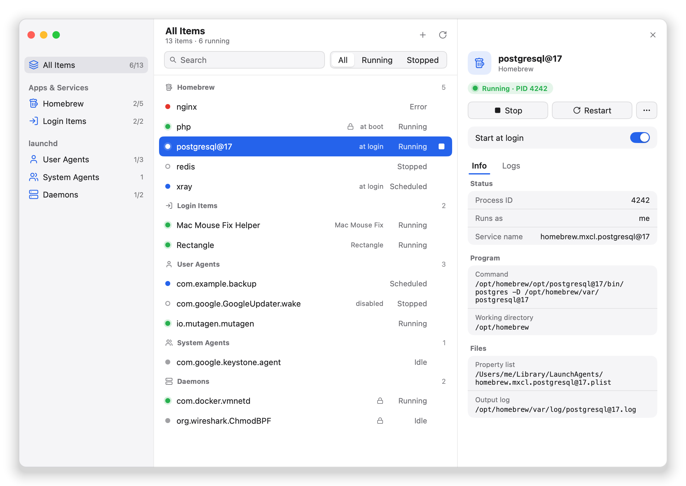
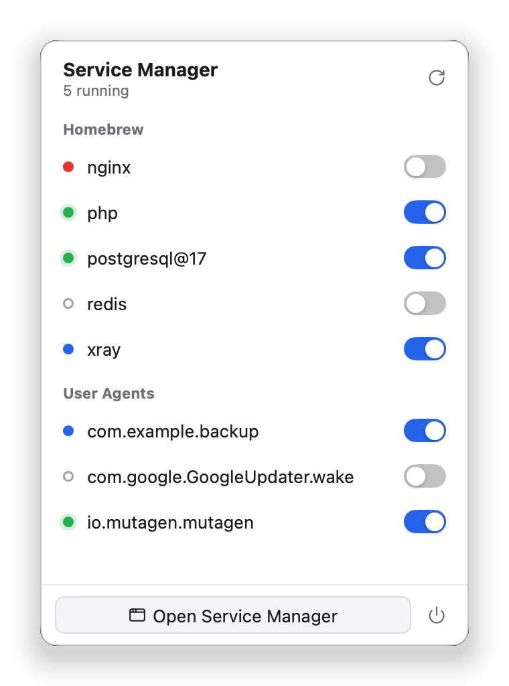
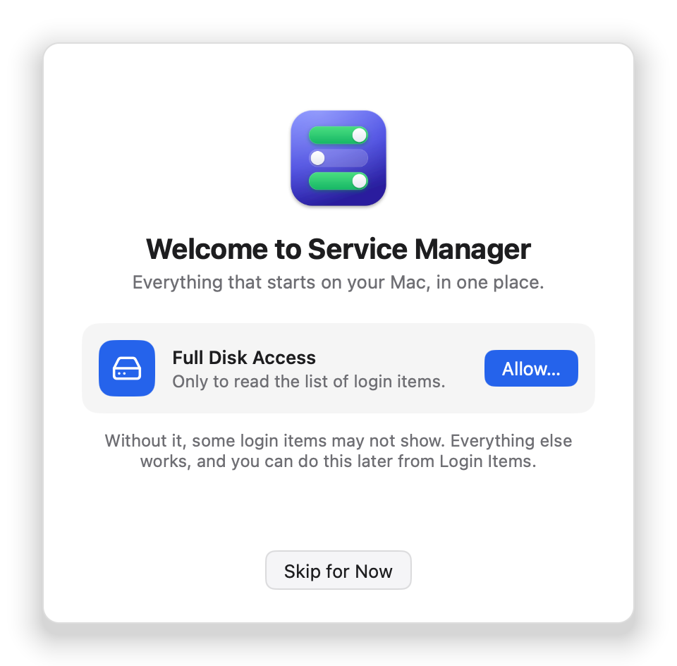
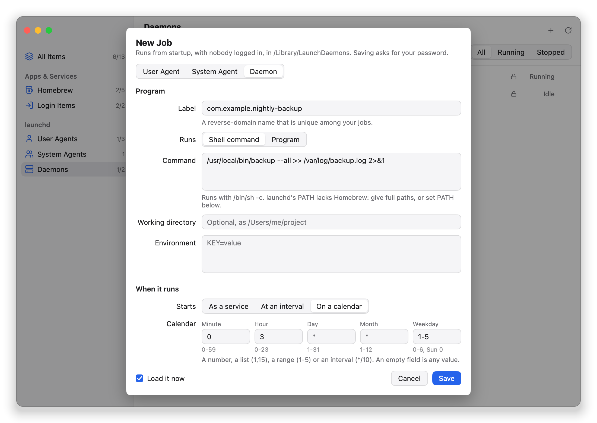

<div align="center">


# macOS Service Manager

**Everything that starts on your Mac, in one place.**

Homebrew services, launch agents and daemons, and login items, in one native app
drawn on the GPU, with no webview and no JavaScript.


[](https://github.com/egoist/mygo)

[Features](#features) · [What it manages](#what-it-manages) · [Jobs](#create-and-edit-jobs) · [Permissions](#passwords-and-permissions) · [Install](#install) · [Development](#development)

</div>

<br>

<picture>
  <source media="(prefers-color-scheme: dark)" srcset="docs/images/window-dark.png">
  
</picture>

## Features

- **One list for everything.** Search every source together, filter by running or
  stopped, and see each item once: a Homebrew service is not listed again as a
  launch agent.
- **Details at a glance.** Status, command, files, a switch for whether the item
  starts by itself, and its **live logs**, followed as they grow.
- **Launchd jobs without writing a property list.** Create, edit and remove user
  agents, system agents and daemons, with schedules in the fields of cron.
- **Act on several at once.** ⌘-click or Shift-click to start or stop items
  together. Daemons changed together ask for your password once.
- **Stays in the menu bar.** Close the window and the app stays. Its icon shows how
  many Homebrew services and user agents run, and opens a panel with a switch for each.
- **Asks only when macOS requires it.** Reading never asks for a password, and a lock
  icon marks what changing will.

<p align="center">
  <picture>
    <source media="(prefers-color-scheme: dark)" srcset="docs/images/menu-bar-dark.png">
    
  </picture>
  <picture>
    <source media="(prefers-color-scheme: dark)" srcset="docs/images/welcome-dark.png">
    
  </picture>
</p>

## What it manages

| Source | Read from | What you can do |
|---|---|---|
| **Homebrew services** | `brew services`, and launchd for services registered as root | Start, stop, restart; start at login |
| **Login items** | System Settings' database, with Full Disk Access; otherwise System Events, for apps only | Add and remove the apps that open at login. Helpers that apps registered are read-only; System Settings has their switch |
| **User agents** | `~/Library/LaunchAgents` | Load, unload, start, stop, restart; enable, disable; create, edit, remove |
| **System agents** | `/Library/LaunchAgents` | The same; creating, editing and removing take your password |
| **Daemons** | `/Library/LaunchDaemons` | The same; every change takes your password |

## Create and edit jobs

**New Job…** writes the property list, checks it, and loads the job if you ask, whichever
kind it is. Its options follow [Launched](https://launched.zerowidth.com/).

<picture>
  <source media="(prefers-color-scheme: dark)" srcset="docs/images/new-job-dark.png">
  
</picture>

| Option | What you can set |
|---|---|
| **Command** | A shell command, run with `/bin/sh -c`, or a program with its arguments |
| **Environment** | Working directory and environment variables |
| **As a service** | Start at login or boot; restart never, after a crash or always; start when a disk mounts, or while a queue directory has files |
| **At an interval** | Every so many seconds |
| **On a calendar** | Minute, hour, day, month and weekday, each a number (`5`), a list (`1,15`), a range (`1-5`) or an interval (`*/10`). An empty field is any value |
| **Logs** | Output and error files. New jobs can log to `<label>.log` in `~/Library/Logs`, or in `/Library/Logs` for a daemon that runs as root |
| **Runs as** | Daemons only: user, group and root directory, which launchd ignores outside the system domain |

Editing keeps what the form cannot show: other keys of the file, `KeepAlive`
conditions, and calendars that are not all the combinations of their values.

## Passwords and permissions

| When you | macOS asks for | How often |
|---|---|---|
| Read any source | Nothing, apart from what login items need below | |
| Change user agents, or Homebrew services that run as you | Nothing | |
| Load, start or stop a system agent | Nothing: it runs in your session | |
| Change a daemon, or a Homebrew service registered as root | Your password | Each time; several daemons together ask once |
| Create, edit or remove a system agent or daemon | Your password | Each time |
| List the helpers in Login Items | Full Disk Access | Once |
| List login items without that access, or add or remove one | Permission to control System Events | Once |
| Read the helpers with `sfltool dumpbtm` instead | An administrator | Every time, and only when you ask |

**Before the password,** editing a system agent or daemon lists the keys of its file
that will change, and asks nothing at all if none do. Removing one says what you will
lose. Software you installed may depend on these jobs, or undo your edit when it updates.

**Full Disk Access is optional.** The first launch offers it and says what skipping it
costs; Login Items offers it again later. Allowing it opens System Settings, where a small
page follows the window with an icon to drag, shows the way into the list, and darkens
everything else during the drag.

> [!WARNING]
> **The Trash is not an undo for system agents and daemons.** Removing one unloads it and
> moves its file to your Trash, but Put Back cannot return it to where launchd reads it.
> To get it back, reinstall the software it came from, or install the file again as root:
>
> ```bash
> sudo install -m 644 -o root -g wheel com.example.job.plist /Library/LaunchDaemons/
> sudo launchctl bootstrap system /Library/LaunchDaemons/com.example.job.plist
> ```

## Install

Build it from source. You need:

- macOS 12 or later
- Go 1.27.3 or later
- Homebrew, only for the Homebrew source

```bash
git clone https://github.com/tdawn0-0/macOS-service-manager.git
cd macOS-service-manager
go tool mygo build
```

The app and a disk image are in `build/darwin-arm64/`, or `build/darwin-amd64/` on Intel.
To sign with a Developer ID, see [Packaging](#packaging).

> [!NOTE]
> The `msm-v0.1.0` release on GitHub is the earlier Tauri app, from before this rewrite.

## Keyboard and mouse

| Input | What it does |
|---|---|
| <kbd>⌘</kbd> <kbd>R</kbd> | Refresh |
| <kbd>⌘</kbd> <kbd>F</kbd> | Go to the search |
| <kbd>⌘</kbd>-click, <kbd>⇧</kbd>-click | Choose several items |
| Right click on a row | List everything that can be done to it |

## Development

```bash
go tool mygo dev      # run with live reload
go test ./...         # views run without a window; backends run on stubbed commands
go tool mygo build    # a build for this Mac, signed ad hoc
```

### Project layout

```
main.go, menubar.go     the window, and the menu bar icon with its panel
guide.go                the welcome guide, its window, and the overlay that shows where to drag
app.go                  the state, and the background work that changes it
view*.go                sidebar, list, details, logs, the editor of launchd's jobs
theme.go, icons.go      the look: colors, status dots, buttons, icons
internal/service        the model every source shares: Item, Action, Provider
internal/brew           Homebrew services
internal/launchd        launch agents and daemons; the plist editor (edit.go), calendars (calendar.go)
internal/loginitem      login items, from System Settings' database (database.go)
internal/logs           the end of a log file
internal/system         running commands, as root through macOS' own prompt; where System Settings' window is
docs/images             the pictures of this page
```

Each source is a `service.Provider`; the interface knows nothing of Homebrew or launchd.
State is read and written on the main thread only; commands run in a goroutine and hand
their result back with `Window.Update`.

### Packaging

```bash
scripts/package.sh                 # universal, signed: build/darwin-universal/*.app and *.dmg
scripts/package.sh --arch arm64    # one architecture (arm64 or amd64)
scripts/package.sh --skip-tests    # without running the tests first
```

The script signs with the keychain's `Developer ID Application` certificate, or
`SIGNING_IDENTITY`, with the hardened runtime and a timestamp, and checks the app and the
disk image. Other Macs warn before opening what is not notarized, so give it a profile to
notarize and staple the disk image:

```bash
xcrun notarytool store-credentials msm --apple-id <you> --team-id <team>
NOTARY_PROFILE=msm scripts/package.sh
```

The app signed this way is a new app to macOS: it asks once more to control System Events,
and needs Full Disk Access allowed again. The same certificate keeps both across versions.

Pushing to the `release` branch tests and builds both architectures, and uploads the disk
images to a draft release named after the version in `mygo.json`. Those builds are signed
ad hoc.

### Icons and pictures

`assets/icons/*.svg` are the sources, and `scripts/icons.sh`, which needs `rsvg-convert`,
renders them: `resources/icon.png` becomes the app's icon, `resources/icon-dev.png` the icon
of `mygo dev`, and `assets/icons/menubar.png` the menu bar's, black on transparent for macOS
to tint. `assets/icons/guide.png` and `drag.png` are the welcome guide's icon, and what
follows the pointer as it is dragged.

```bash
MSM_README_SHOTS=docs/images go test -run TestReadmeShots .    # the pictures of this page
MSM_SHOTS=<dir> go test -run TestShots .                       # every pane: light, dark, smallest size
```

The pictures of this page are drawn from made-up items, so that no machine's own jobs end
up in them. The test adds the window's corners, shadow and controls, which macOS draws in
the real app.

### Testing on a real Mac

- **Test permissions with `open`, not from a terminal.** A process started from a terminal
  that has Full Disk Access inherits it, and hides what a launched app is refused.
- **Do not run `launchctl enable` or `disable` on a throwaway label.** launchd keeps the
  record after the job is gone, no launchctl command removes it, and macOS refuses even root
  when it tries to edit that file.

## How it works

<details>
<summary><strong>Login items</strong></summary>

<br>

They come from `/private/var/db/com.apple.backgroundtaskmanagement`, which macOS lets an app
read only with Full Disk Access. The database's format is Apple's own and changes with macOS.

Without that access, System Events lists the apps that open at login, and the list says that
it leaves out the helpers, with two ways to change that: allowing Full Disk Access, once,
through the guide, or `sfltool dumpbtm`. While the guide is open the source is not read, so
that System Events asks nothing that allowing the access would make needless. `sfltool` asks
for an administrator every time it runs, so the app runs it only when you ask, and keeps its
answer in your cache directory, showing how old it is.

</details>

<details>
<summary><strong>Homebrew services</strong></summary>

<br>

Starting at login is the service's property list in `~/Library/LaunchAgents`, which the switch
adds and removes itself, as `brew services start` and `stop` do, but without starting or
stopping the service. Start and Stop are `brew services run` or `start`, and `stop` or
`stop --keep`, chosen to leave that as it is.

Services registered as root (`sudo brew services`) are jobs of the system domain, of which
`brew services` run as you reports nothing. Their state comes from launchd, and they change
with `launchctl`, after macOS asks.

</details>

<details>
<summary><strong>Changes that take root</strong></summary>

<br>

They go through `osascript … with administrator privileges`, which shows macOS' own dialog.

- **A new job** is written to a temporary file, checked, and installed by root as `root:wheel`,
  without which launchd refuses it. A daemon loads in the same step, so that macOS asks once.
- **An edit** replaces the file all at once, and only then unloads and loads the job, so a
  failure leaves the job running as it was. If the job will not load, the form says the file
  was saved, and saving again edits it.
- **A removal** unloads the job, then has root hand the file over through a temporary
  directory for the Trash to take. A job that launchd will not unload is not removed, since
  it would run on without a file.

</details>

## Credits

Built with [MyGo](https://github.com/egoist/mygo). The options of the job form follow
[Launched](https://launched.zerowidth.com/).
