# 开发工作区界面与 UI E2E

界面直接实现在 Go + MyGo 中。主导航保留旧系统服务入口；Development 的四个页面使用左侧列表、右侧详情，避免把全部操作堆在一个长表单里。

- 项目：总览、服务、环境、日志。底部固定保存按钮；保存后留在当前页。服务重命名更新原记录，环境字段按项目隔离。总览显示 .nvmrc、.node-version、package.json、PHP 等版本声明来源，精确版本冲突明确提示；选择运行时不会改写仓库文件。
- 软件：六类软件、建议版本和精确版本输入。先预览来源、SHA-256、架构、最低系统、许可、体积和安装目录，再安装；已安装版本可以直接用于项目。
- 数据库：创建和已有实例分开显示。SQL/MongoDB 提供库和用户操作；Redis 使用编号数据库，不展示无效的建库、建用户按钮。可重启、复制可用连接 URI、单独复制密码和打开默认客户端；展示引用项目。
- HTTPS：站点列表、归属项目、域名和上游；规则保存和实际应用分开。高级选项可配置连接/响应头超时和 Host 策略，需要系统授权的功能由用户显式点击。

顶部 Diagnostics 打开独立诊断页：按层显示状态、说明和修复步骤，标明快照时间；复制和导出使用匿名资源名，返回后保留工作区草稿。

明暗主题都使用项目现有原生控件。默认窗口为 1120×720，最小窗口为 900×520。长项目名省略显示，详情可滚动，保存和结果状态固定在底部。

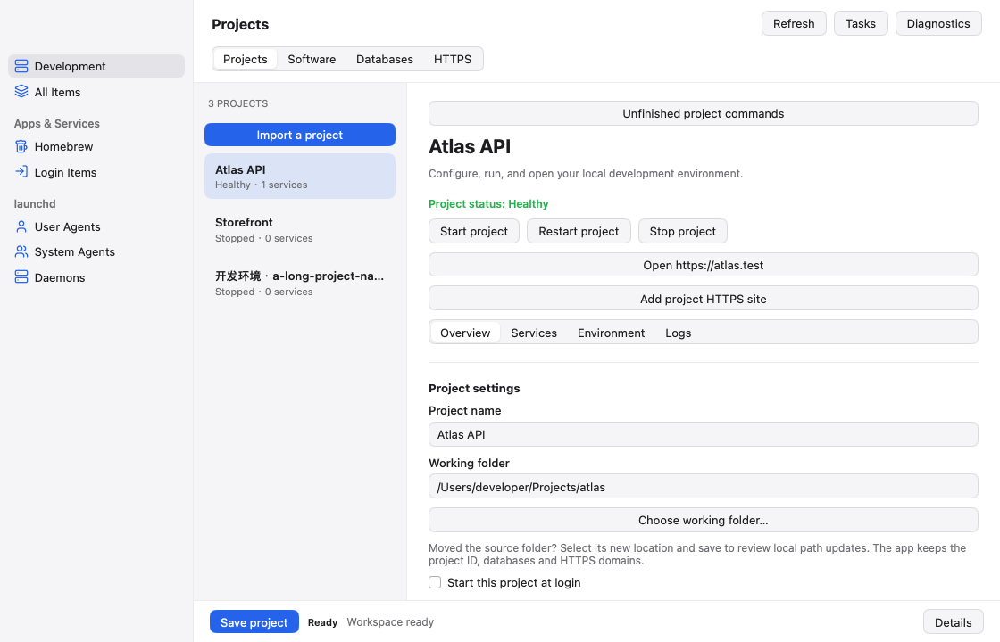

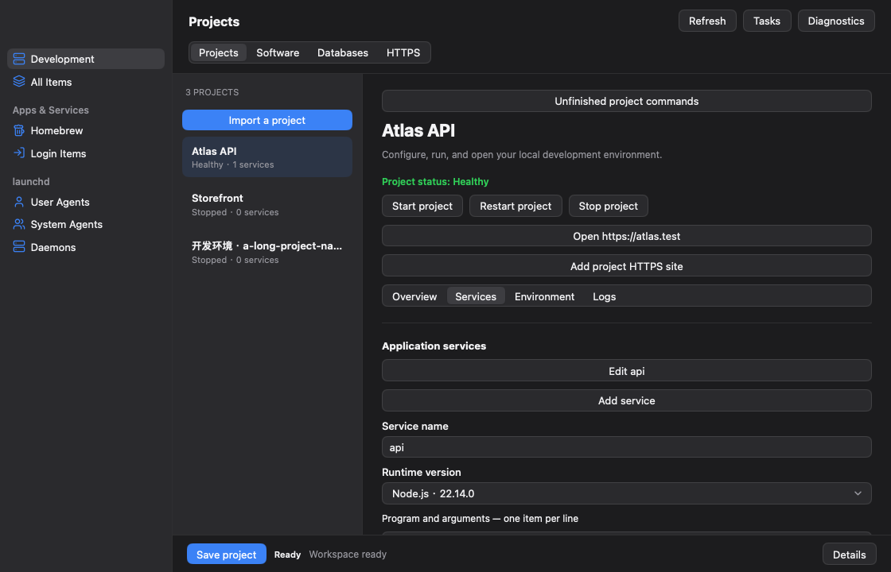

这些图片使用固定示例数据，由实际 UI 渲染器生成；没有使用本机项目、密码和数据库内容。软件预览中的摘要和体积也是示例，不能当作真实安装清单。

## 测试方式

`development_e2e_test.go` 用 MyGo 的输入与命中测试接口点击、输入、选版本、滚动，并运行真实异步任务。后端使用独立目录、下载校验后的真实二进制、launchd 服务和真实 TLS 请求。

普通 UI 测试将管理员授权入口替换为直接报错。CA 修复专用用例还拦截钥匙串命令，模拟信任结果和授权取消，禁止写入本机钥匙串。浏览器“打开网站”测试记录 URL 交接，不自动打开浏览器。它们属于原生 UI 引擎的无窗口 E2E，不等同于 Finder、原生文件选择器或系统授权窗口的桌面自动化。

普通测试覆盖项目导入、单次保存、服务重命名、环境隔离、启动、可信 TLS 请求、日志、菜单栏启停、停止、表单校验、站点重命名/移动/删除、异步取消及旧权限入口隔离。闭环还经 UI 运行诊断、复制匿名报告、实际写出报告文件并核对内容；隔离 CA 缺少系统信任时，报告必须显示 TLS 失败。

带包缓存的测试还通过 UI 安装与卸载全部六类软件。四种数据库均通过界面创建实例、启停、查看连接、建库和建用户（Redis 除外）、备份、恢复到新库、移除管理记录；测试写入真实数据并在恢复后核对，确认移除记录仍保留数据文件。缓存只省去重复网络传输，安装仍重新校验摘要。

```sh
go test -race -run '^TestUI' -count=1 -v .
MSM_UI_E2E_PACKAGE_CACHE='/path/to/cache1:/path/to/cache2' \
  go test -race -run '^TestUI' -count=1 -v .
MSM_DEV_DESIGN_SHOTS=/tmp/msm-design-review \
  go test -run TestDevelopmentDesignLayouts -count=1 .
```

缓存未配置时，真实软件包安装和数据库操作用例明确显示 SKIP。不能把 SKIP 当作通过。当前设计用例生成 252 张截图：六十三个详情视图 × 两种尺寸 × 两种主题。运行时声明、服务健康设置、软件预览、高级代理和初始化恢复视图滚动至相关控件以便检查。

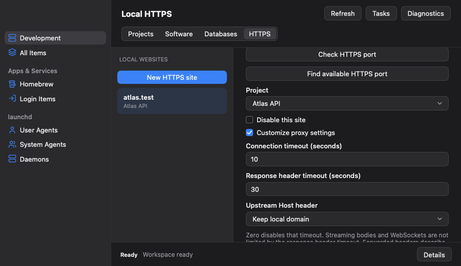

当前 Mac 的浏览器证书信任与默认 443 已通过 Chrome、Safari 实机验证，见 [验证记录](development-verification.md)。2026-11-07 又从打包后的原生 App 验证了四个页面、服务控件、日志读取、系统目录选择器的路径回填，并从 App 打开默认 HTTPS；Chrome 再次显示“连接是安全的”。该轮没有触发管理员授权。它不替代干净机器安装或新系统授权的完整测试。当前范围仅 Apple Silicon，Intel 已移除。

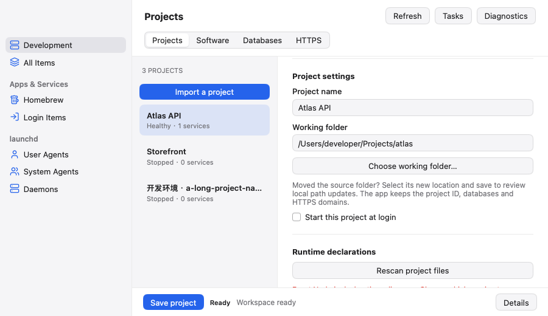

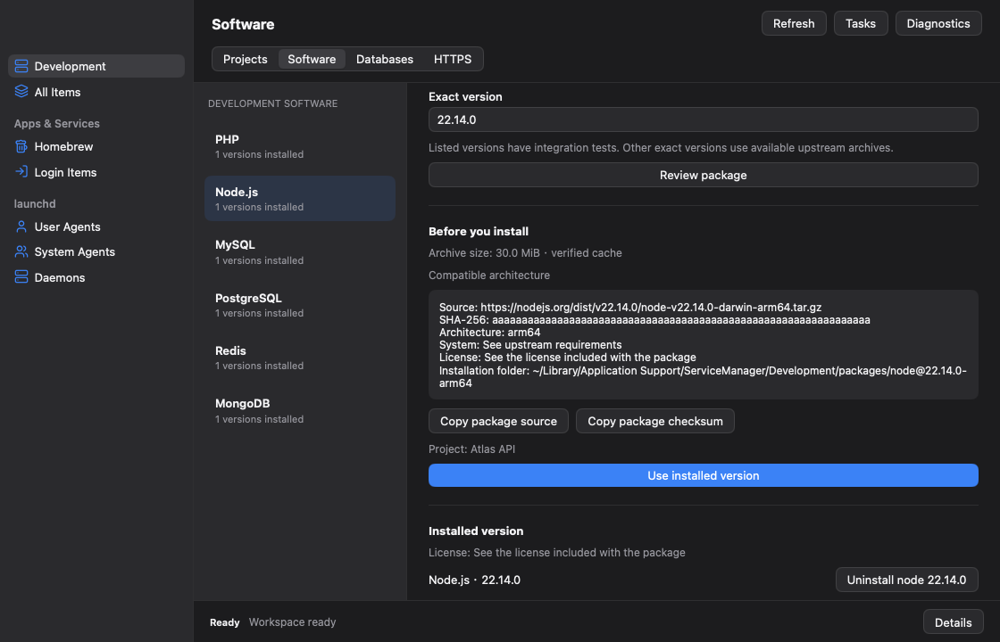

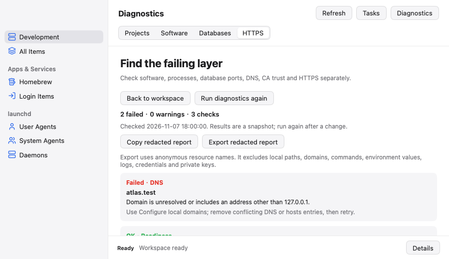

带 Node 缓存的新增 UI 流程验证：导入冲突声明 → 选择精确版本 → 预览但不安装 → 修改版本后禁止使用旧预览 → 安装并绑定项目草稿 → 保存 → 启动 npm → 通过 HTTPS 核对实际 Node 版本 → 停止并确认 Node 子进程端口释放。上游元数据用例另验证不在建议列表中的 Node 22.13.1 和不存在的版本；只读元数据不算实际安装该版本。

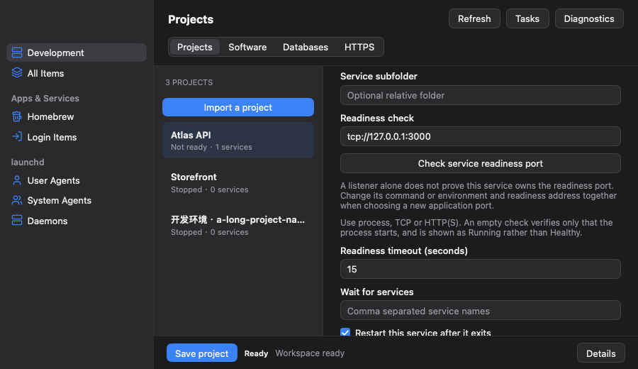

新增最小暗色窗口 UI E2E 验证无效超时不落盘、保存 1 秒就绪超时及 3 秒重启节流、Starting/Stopping 阶段、真实 503 启动超时、修正后 Healthy、服务仍运行但健康失败时 Not ready。异步状态刷新也经过真实渲染帧触发；单独回归验证旧查询不会覆盖新操作或未保存草稿。

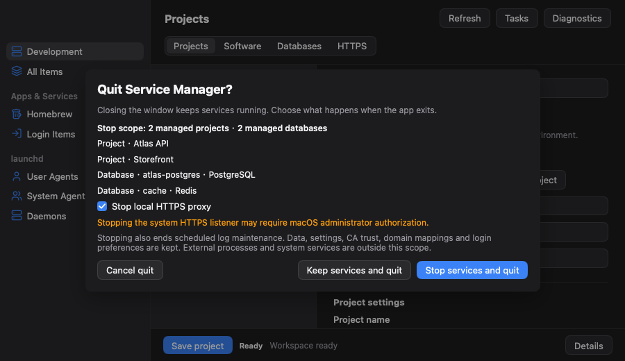

退出选择使用独立弹窗和固定按钮栏，长资源列表在弹窗内滚动。可取消、保留服务退出，或按预览停止受管资源。可单独保留 HTTPS；需要管理员权限的监听会先提示。正在执行任务时不能直接退出；停止失败会保留窗口并提供重新预览和重试。最小窗口、明暗主题的范围与失败状态均已渲染检查。

新增真实 UI E2E 从菜单栏 Quit 入口操作上述选择，验证未保存的草稿提示、保留后的真实监听、模拟停止拒绝后的重试、最终项目/HTTPS 端口释放以及外部 HTTP 进程不受影响。退出回调被捕获以保护测试进程；没有实际退出当前桌面 App，也没有触发系统授权。

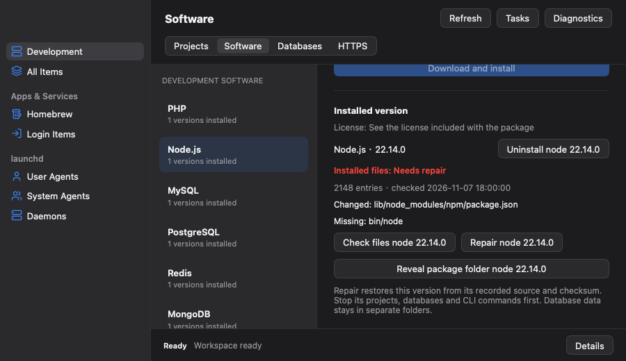

已安装版本显示最近完整性检查状态、时间与文件差异。Check files 和 Repair 在最小窗口中可访问；路径长时换行，查看目录单独操作。修复工作在后台显示阶段并可取消。Node 的真实无窗口 UI E2E 覆盖非二进制文件损坏、检查、修复、查看正确目录、运行中拒绝修复、停止后恢复与实际版本执行；数据库目录哨兵保持原值。


共享环境导入后，项目显示待补项目清单，启动按钮在配置完成前禁用。Complete local setup 按缺失项打开服务、环境或 HTTPS 页面。Services 中的 Values on this Mac 使用独立参数字段：本机文件可选择，秘密值遮罩，命令编辑器保留占位符；保存时填入真实命令参数。Environment 提供本机环境文件选择和必需变量名提示。未确认的外部上游不会进入代理路由。

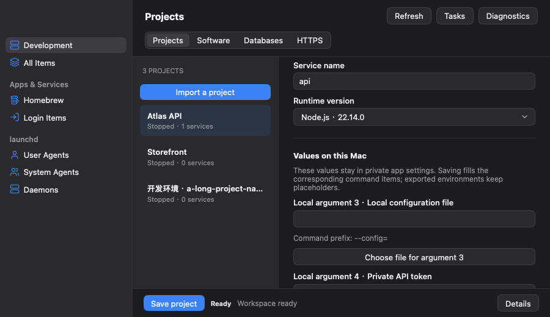

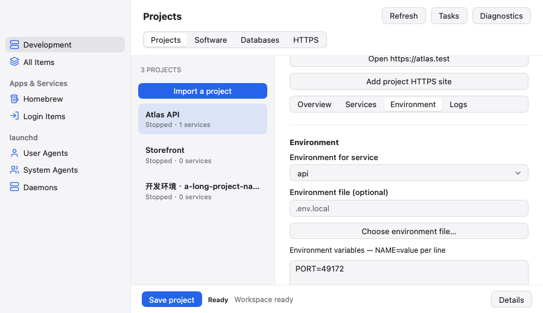

新增 UI E2E 在最小明暗窗口操作共享环境的导出、复制、导入和本机补填：两个真实 Python 服务同时运行，各自分配应用端口及域名，共用已有高位 HTTPS 监听；请求分别返回对应工作副本内容。配置前启动受阻，本机执行路径、文件参数和环境值不会再导出。另有秘密参数输入、前缀拼接、保存后命令编辑器占位符和再次导出的回归。它们使用隔离 CA 验证 TLS，不改变系统信任或 hosts；不能替代新一轮原生系统授权验收。


导入页面及项目总览提供 Review export recovery。未完成的导出会自动阻止导入并显示恢复预览，包含操作编号、准备时间、项目名、锁定软件版本和两个文件的保存状态。Complete interrupted export 完成当时准备的快照。文件改动后完成按钮禁用；Discard export record (keep files) 只删除操作记录，两个文件保持当前内容，之后可从注册项目重新导出。页脚显示 Export recovery，正文可滚动。

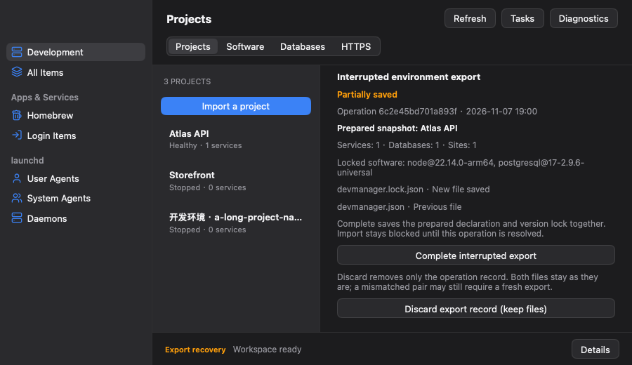

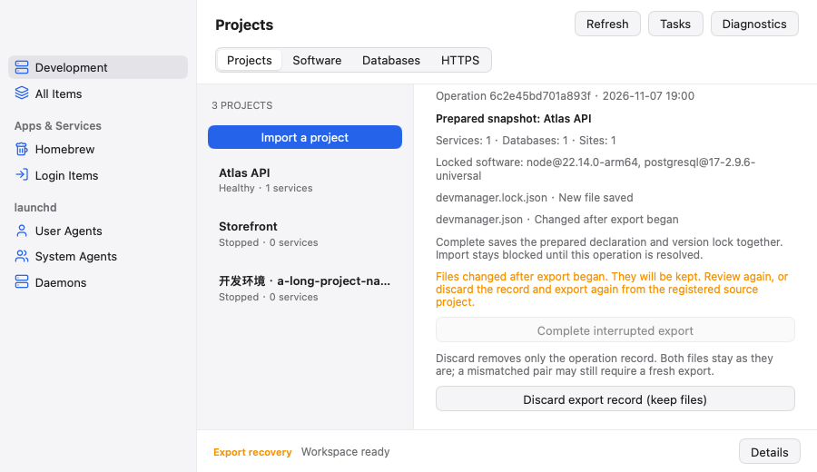

TestUIExportRecoveryCompletesOrKeepsChangedFiles 使用实际中断的导出，在最小明暗窗口验证导入受阻、完成恢复、新项目导入、外部改动时禁止覆盖、丢弃记录后文件原样保留，以及重新导出后的有效配对。它没有手动编辑声明来完成配置，没有调用管理员授权。


项目目录不可用时显示定位提示，并禁用启动和重启；停止仍可用。Overview 的 Choose working folder 支持系统目录选择，Working folder 也可直接输入。修改目录后 Save project 先打开路径调整预览，Apply folder change 才保存；Cancel 恢复原目录字段。预览后继续编辑会禁用 Apply，须重新保存预览。运行中的项目及无法确认停止状态的任务不能应用目录变更。

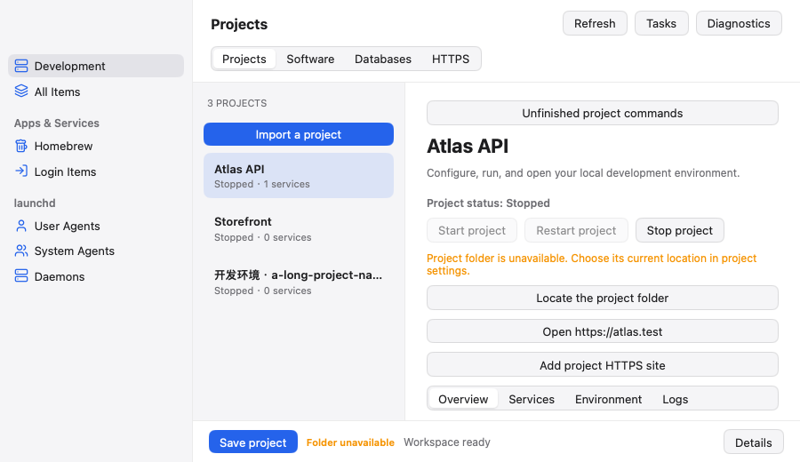

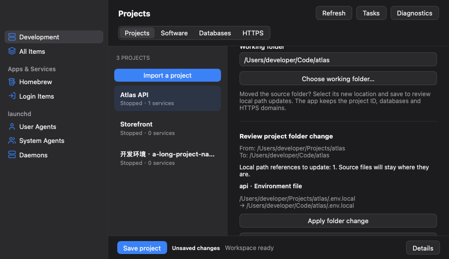

项目顶部新增 Add project HTTPS site。它按项目名生成 .test 域名，避开现有、停用和待审阅的声明；优先使用已配置的 HTTPS 监听，并根据本地健康地址或 PORT 建议上游。站点归属预选当前项目，保存、应用代理和系统授权仍由用户分别发起。

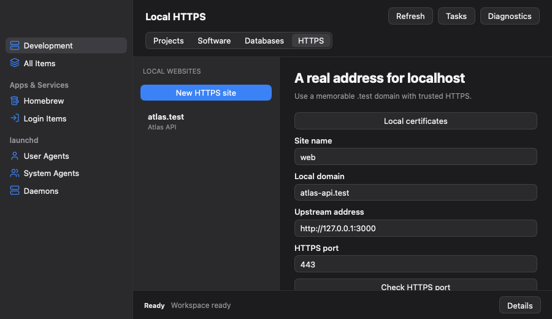

TestUIProjectFolderRelocationAndReopenKeepsHTTPSIdentity 在 900×520 明暗窗口通过真实 UI 创建项目和建议站点，启动实际服务与 TLS，验证运行时拒绝迁移、停止后移动源码、目录缺失提示、预览/取消/重新预览、编辑后禁止应用旧预览，最后调整两条本机路径并保存。全新的 App/view/Manager 实例重新读取同一私有目录，再启动和重启服务；同一域名返回迁移后的文件内容、新环境值和实际新工作目录。这里的“重开”是 UI 引擎实例重建，不是原生 macOS 进程退出重启或登录事件。


HTTPS、数据库端口表单提供 Check port 和 Find available port。检查显示 IPv4 回环绑定状态、时间、可见监听的 PID / UID / 进程名 / 地址；不读取完整命令行或环境变量，不按 PID 停止进程。查不到进程时仍显示已观察到的占用，不猜测归属。In use 也可能是正常运行的受管服务，不会单凭名称判定冲突。服务页可检查就绪地址的端口；更改应用端口仍通过命令、环境和就绪字段完成。

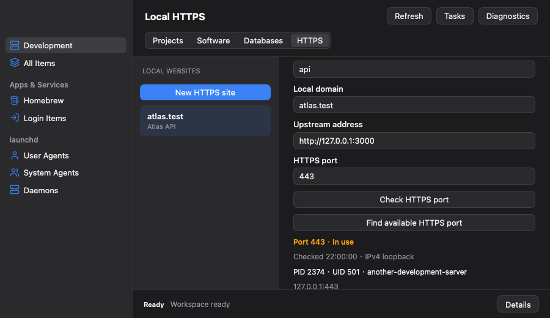

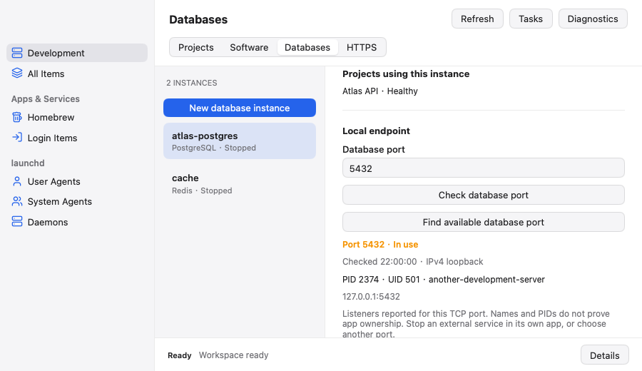

已有实例可以 Save database port。运行实例或关联项目未停止时拒绝；端口保存保留数据、用户、密码和实例 ID。恢复性入口 Repair saved port settings 将工作副本恢复到已保存的端点，不会重新初始化数据库；自定义且有歧义的配置会被保留并报错。

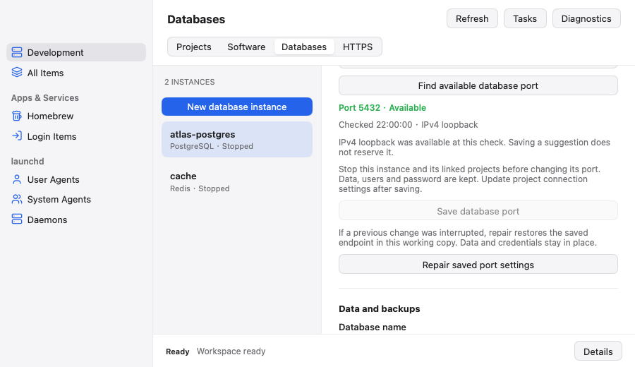

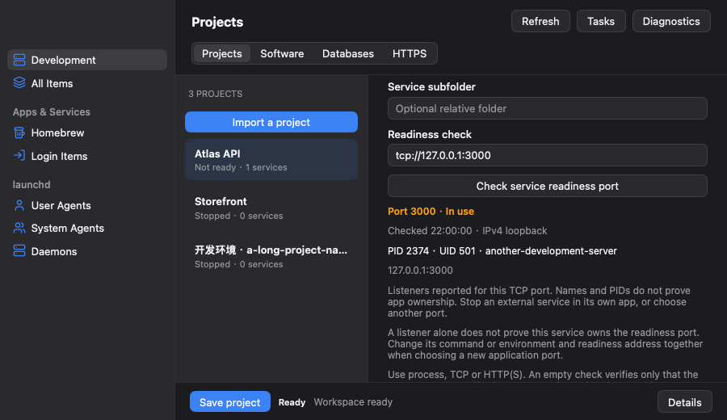

新增 HTTPS UI E2E 在最小明暗窗口制造真实监听占用，确认显示实际 PID，原已部署站点及代理 PID保持，再建议高位端口、保存、应用和请求真实 TLS；外部监听仍可连接。六软件 UI 矩阵现使用最小暗色窗口；四数据库均覆盖运行时拒绝改端口、停止后冲突、查看进程、建议并保存新端口、用原密码读取源库和恢复库的 42。Redis 导入工作副本还覆盖改端口后重复 Prepare，以及通过 UI 修复人为注入的中断配置。


HTTPS 的 Local certificates 打开独立证书详情页。当前 CA 展示名称、完整 SHA-256、有效期、证书/私钥匹配状态及 macOS 验证结果；只有有效且验证为 Trusted 才显示绿色。复制操作只复制公开指纹。未创建、过期、材料损坏和未信任都有对应状态。

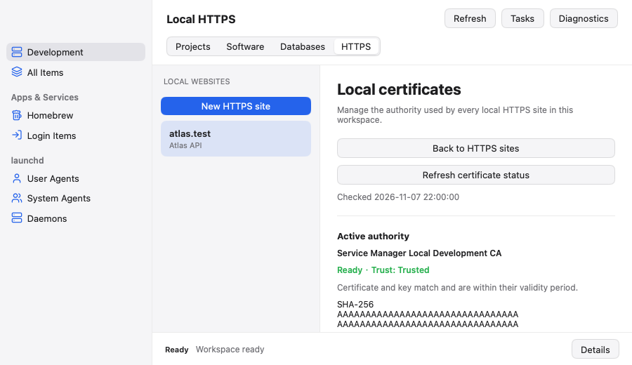

更换流程为 Prepare replacement CA → 核对指纹 → Trust prepared CA → Stop HTTPS proxy → Activate prepared CA → Apply proxy。信任验证未通过时不能切换；运行中的代理也会阻止切换。授权取消保留当前 CA。已保存 CA 可重新信任、恢复使用，或按精确指纹移除其信任。过期 CA 不能恢复为当前 CA。长内容在详情内滚动，页脚任务状态保持可见。

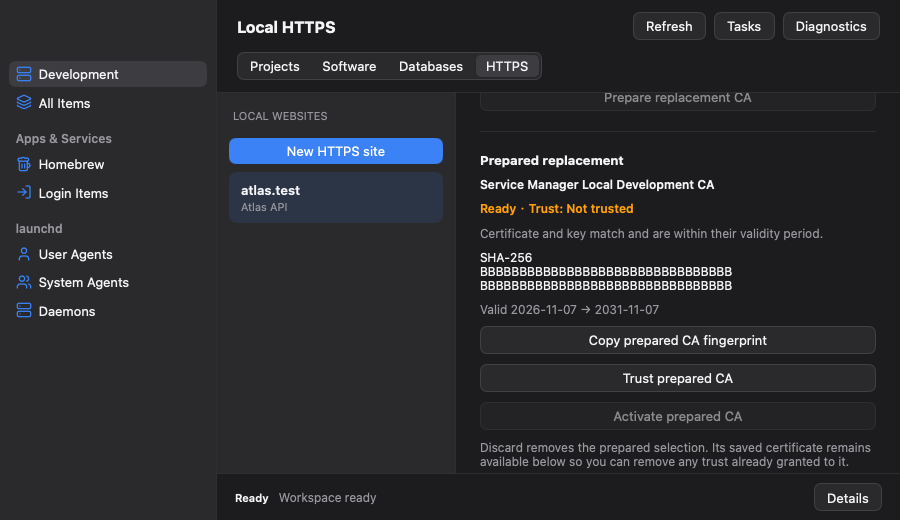

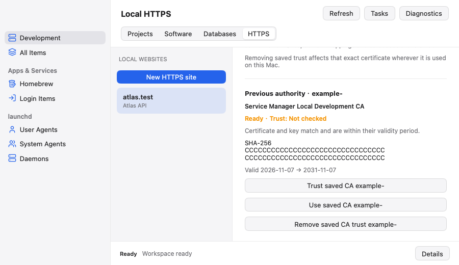

TestUIAuthorityRepairTrustCancellationActivationRollbackAndTLS 在 900×520 明暗主题下操作过期 CA 修复、模拟授权取消、信任、运行时拒绝切换、停止后激活、恢复有效旧 CA 和清除弃用信任。代理使用真实 launchd 任务与隔离 CA 完成 TLS 请求；钥匙串写入完全模拟。本轮没有替换当前 Mac 已信任的 CA，也没有新做原生浏览器或系统授权窗口验收。


顶部 Tasks 打开任务列表和详情。阶段、结果、操作 ID 和时间分开显示。项目命令执行也有记录，但不保存参数或输出、不提供自动重放。运行中的记录禁止重试及清理；无结果且操作锁已释放的记录为 Interrupted，不按历史 PID 判定归属。安全任务可 Retry operation；它会创建关联的新操作并重新检查已保存配置、受管 job 和健康。软件重试还校验原包身份和摘要。初始化与恢复需 Review resource settings，使用新目标，不能自动覆盖旧数据。

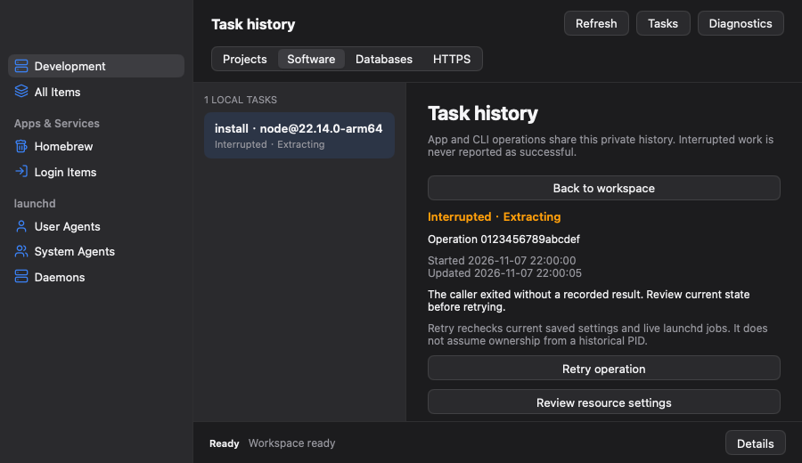

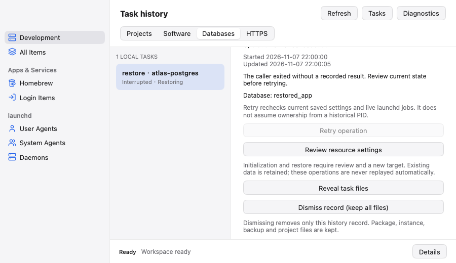

Dismiss record (keep all files) 只清理历史记录；不会停止服务、清理包目录或删除数据库及备份。界面不要求编辑记录文件。原始命令、环境、密码和错误输出不会写入任务历史；实时错误仍在结果栏显示。

TestUITaskHistoryCrashRetryReconcilesLiveServiceAndKeepsFiles 在最小明暗窗口实际结束启动中的 CLI，确认任务中断、通过 UI 重试后原服务 PID 保持、关联任务成功；清理记录后服务和源码仍存在。另验证初始化失败只能转到新实例配置。这里验证真实 CLI 进程退出和原生 UI 引擎交互，不等于 macOS GUI App 退出/登录事件。


数据库的 Review permanent data deletion 打开独立预览，显示实际目录、逻辑文件体积、条目数、关联项目和删除范围。运行中的 job、无法确认停止或仍有关联项目时禁止删除。必须在 Confirm instance ID 输入完整实例 ID；旧预览在元数据或目录改变后失效。Cancel deletion preview 不修改数据。

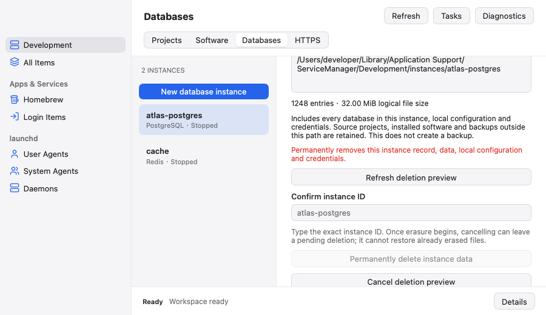

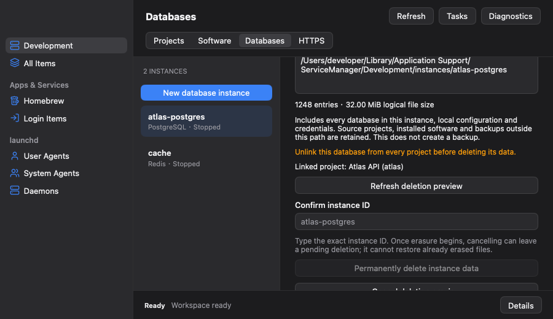

Review pending data deletions 展示中断操作及原目录、暂存目录、剩余体积。实例移除未提交时，只能 Restore original data；已经提交时，需要再次输入实例 ID 才能 Finish permanent deletion。按钮按实际状态启用，不在 App 打开时自动继续。暂存目录不是回收站；已经擦除的文件不能靠取消恢复。

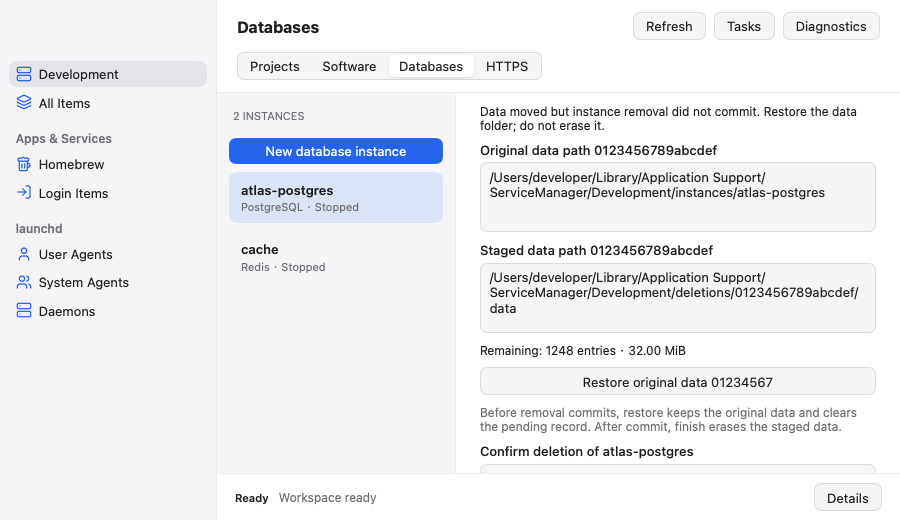

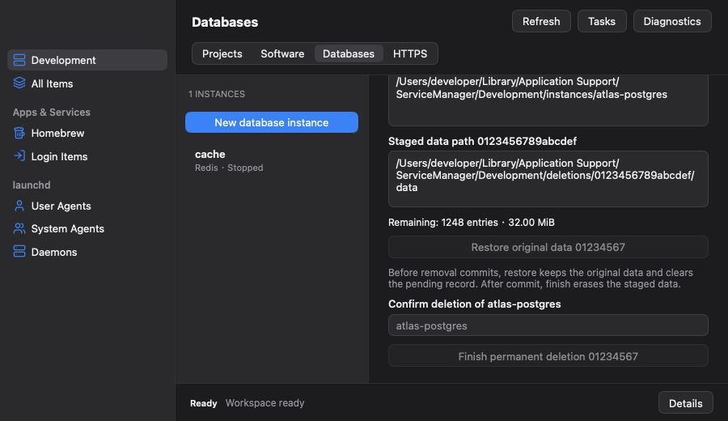

真实 Redis UI E2E 在最小明暗窗口验证运行时拒绝、错误确认、取消预览、过期预览拒绝、成功删除及备份保留，并在新实例恢复出原值 42。另由真实子进程在目录移动后或状态提交后直接退出，回到 UI 恢复原目录并读取 42，或确认继续删除。全流程不编辑 JSON、不触发管理员授权。


软件安装、使用已安装版本和同版本修复使用独立后台任务。Software 按版本显示阶段、结果和 Cancel package；顶部 Package tasks 可随时返回。不同版本可同时准备，其他项目表单仍可输入和保存。完成后重新读取最新状态，保留未保存草稿；安装完成只在目标服务的运行时选择未改变时自动填写草稿，之后仍由用户 Save project。

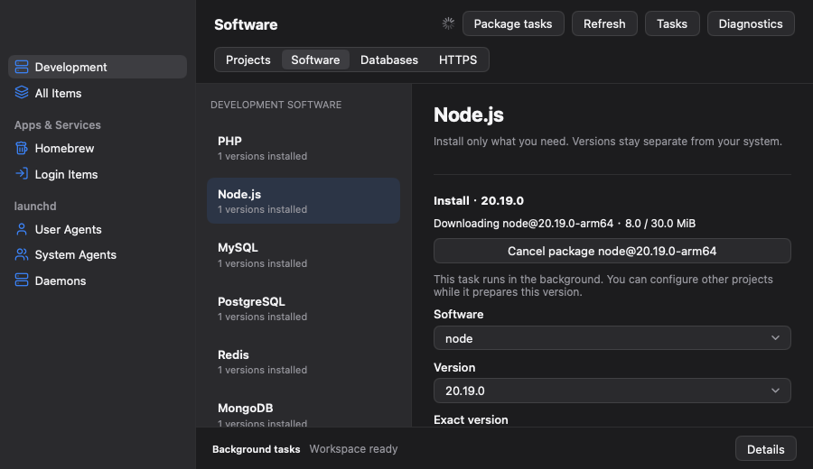

遇到另一个 App/CLI 占用同一版本时，界面显示包身份和处理方法；Review package tasks 打开共同任务记录，显示真实调用者仍在运行及其阶段。调用者完成后可重新预览并使用已安装版本。

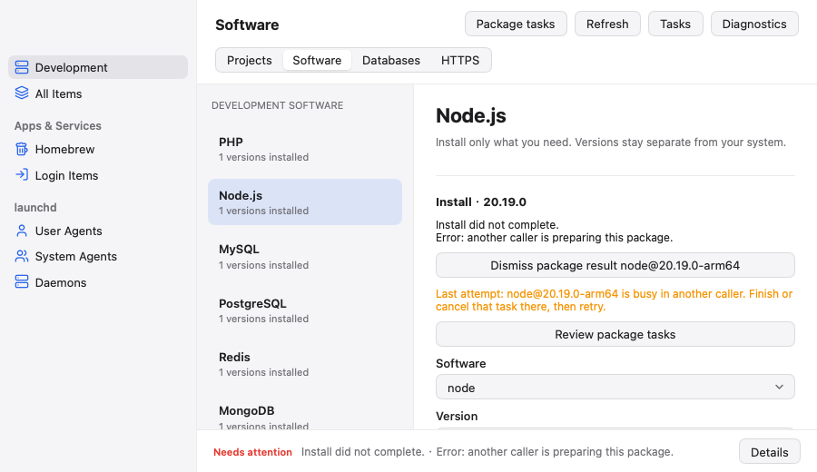

退出对话框包含后台软件和数据库初始化任务。任务未结束时禁用退出，可 Cancel background tasks，再审阅退出范围。关闭窗口仍保留 App 后台工作。

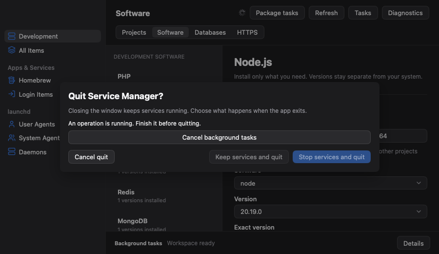

新增最小明暗 UI E2E 同时准备实际 Node/Redis 包，在任务暂停期间保存项目，再修改未保存草稿并模拟其他调用者更新；完成后版本状态和草稿均保持。另验证下载 20.19.0 期间后来选择并保存 22.14.0，旧任务结束不覆盖它，实际 exec 返回 v22.14.0。真实子进程持有同包安装时的占用页/任务记录/重试、单独取消 Node 后 Redis 继续、退出前取消并重新安装均通过。UI 用例复用校验缓存；真正重叠的两个 HTTPS 传输另有核心控制层测试。

数据库创建也使用独立后台任务。顶部 Database tasks 返回进度，每个实例有 Cancel initialization。任务期间可继续保存项目、准备独立实例；完成后的状态刷新保留表单草稿。实例名称、版本、引擎或端口已经改变时，完成任务不会把新建表单切换为旧实例详情。

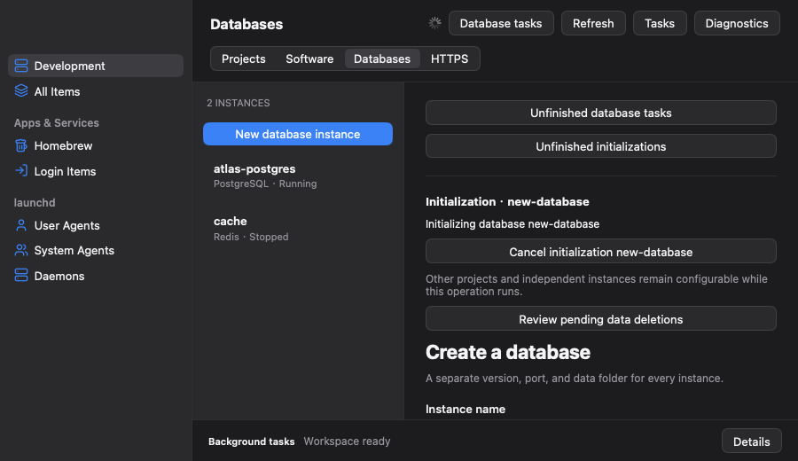

Unfinished initializations 显示正在运行或中断的准备。调用者仍持有租约时不能恢复；退出后，未登记的数据通过 Stop and archive data 保留到独立目录，已登记的数据通过 Finish registration 仅清理初始化记录。界面不自动重放初始化，也不删除暂存数据。长路径换行，操作在详情内滚动访问。

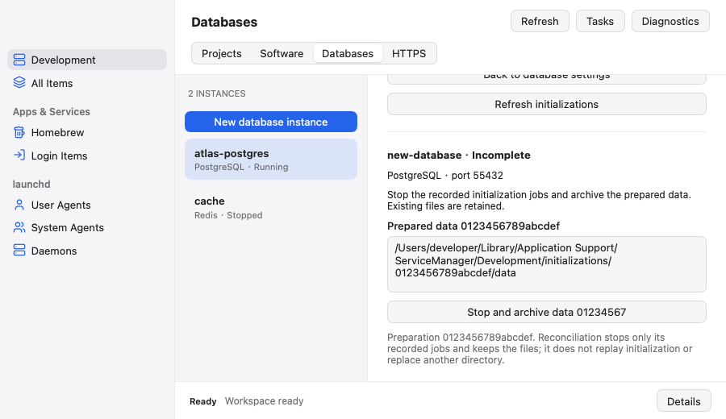

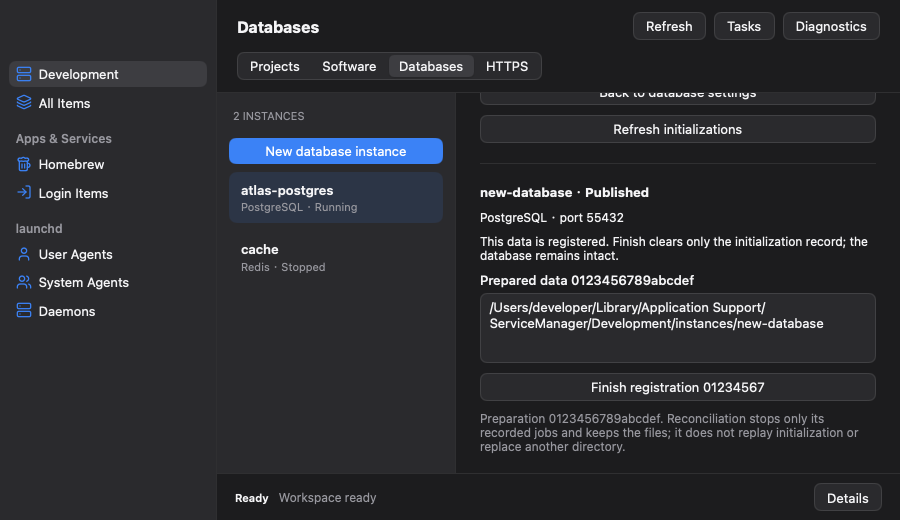

TestUIDatabaseBackgroundInitializationAllowsConfigurationAndKeepsDrafts 在最小明暗窗口验证两个 Redis 初始化、任务期间保存项目、保留后续草稿，最后用实际 Redis PING 得到 PONG。另验证单独取消一个初始化而另一个成功；真实子进程在数据发布后或登记提交后退出，再通过 UI 归档或完成登记，密码文件保持。它们是原生 UI 引擎 E2E，不代替 macOS 原生进程退出或登录验收。


归档已移动、记录尚未清理的准备显示 Archived。Finish archive 只清理记录并保留归档路径。即使原实例 ID 已被新数据库复用并正在运行，也不停止新实例。归档目录身份不匹配时保持 Needs inspection，不把同名目录当作原数据。记录清理实际失败会报错并保留可重试入口。

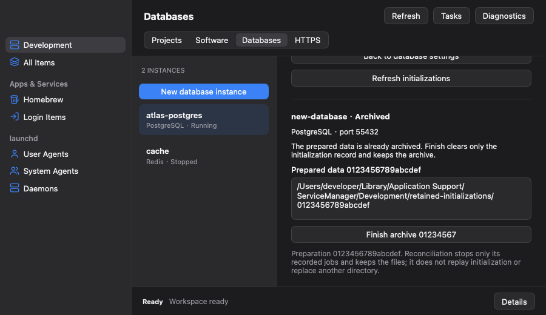

TestUIDatabaseInitializationArchiveCrashFinishesWhileReusedInstanceRuns 在最小明暗窗口实际运行两个子进程：先在初始化发布时退出，再在归档移动后或归档提交后退出。通过 UI 用原 ID 创建并启动新的 Redis，再点击 Finish archive；旧密码文件保持，新实例继续用独立密码响应 PONG。


数据库建库、建用户、备份和恢复也使用按实例区分的后台任务。Database tasks 返回进度，Cancel database operation 单独取消；结果可 Dismiss database result。任务运行时仍可保存项目、创建或操作独立实例；当前实例的启停、删除及另一项数据任务禁用，跨调用者请求由控制层返回具体实例占用。完成刷新不覆盖未保存草稿，也不把数据任务当作新建实例来切换表单。

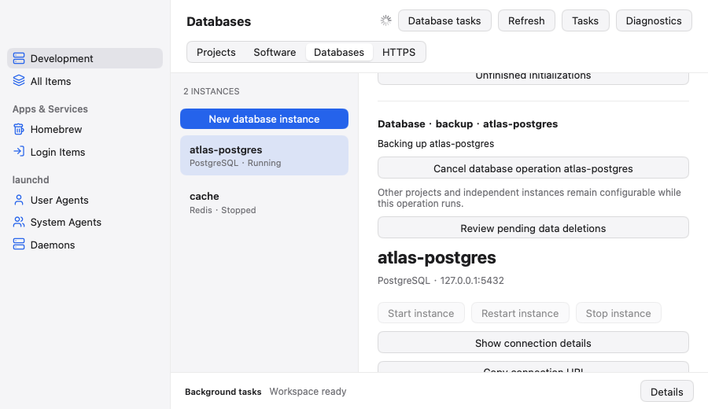

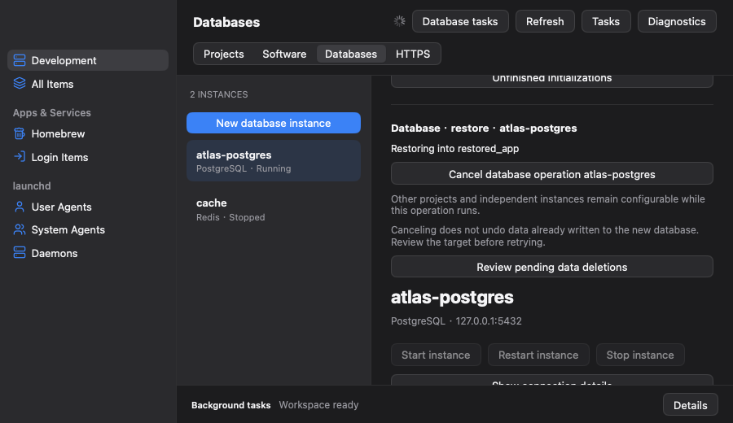

恢复任务提示：取消不能撤销已写入新目标的内容，重试前需要审阅目标。后台任务同样纳入退出等待及 Cancel background tasks。密码只在创建用户时传给操作，不存入任务卡片或阶段文本。

TestUIBackgroundDatabaseBackupKeepsConfigurationAndIndependentInstance 在最小明暗窗口暂停第一个实际 Redis 的备份准备，创建并启动独立 Redis 并完成其备份，通过界面保存项目再编辑未保存草稿。分别验证正常完成、单独取消与重新备份；最后通过 GUI 恢复到另一编号数据库并读出真实值 42。实际两个子进程同时运行、工作区保存及生命周期占用拒绝由控制层专项验证。


新增最小暗色 UI E2E 直接覆盖两个 PostgreSQL 实例：不同端口和管理员密码、同名数据库、应用角色写入 42 / 84，分别备份恢复、停止一个后另一个继续运行、移除记录仍保留数据、重启另一个后数据保持。该项使用真实受管 PostgreSQL 和 launchd，补齐首版的双实例验收。


实例 Start / Stop / Restart / Remove instance 也按实例后台执行，Database tasks 返回进度和取消入口。同一实例的其他修改禁用；独立实例仍可操作。列表保持 Starting / Stopping / Restarting，状态轮询和其他配置刷新不能提前覆盖阶段；完成后重新读取实际状态。结果显示 Started / Stopped / Restarted 加实例名，区别于操作按钮。

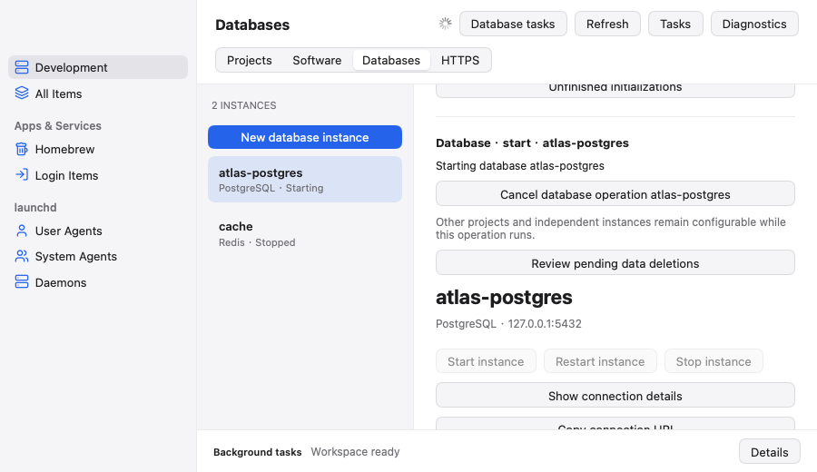

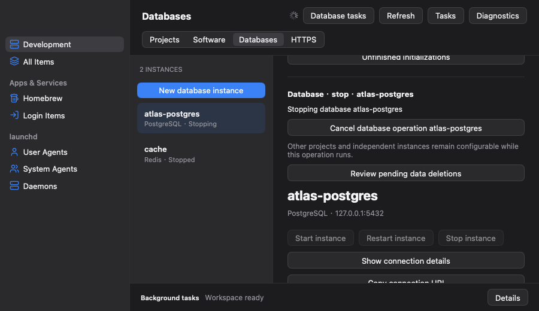


新增最小明暗 UI E2E 暂停真实 Redis 的启动阶段，触发实际异步状态轮询，创建并启动独立实例，通过 GUI 导入和保存独立项目，再修改未保存草稿。分别验证完成、取消及重试，阶段和草稿保持，原数据 42 在重启后仍可读。真实 launchd 进程同时等待就绪及停止等待期间的配置保存，由控制层用例另行验证。


项目 Start / Stop / Restart、准备导入环境和移除管理记录按项目后台执行。菜单栏开关使用同一入口；当前项目的重复操作及保存禁用，独立项目仍可配置。Project tasks 返回进度，Cancel project operation 单独取消；共享数据库被占用时显示具体资源及重试原因。结果可单独关闭。状态轮询及配置刷新保留 Starting / Stopping / Restarting 和未保存草稿；退出前纳入后台任务等待与统一取消。

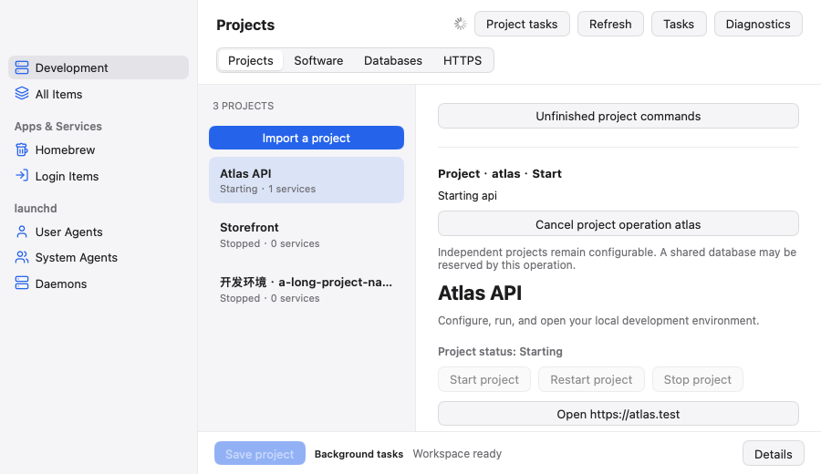

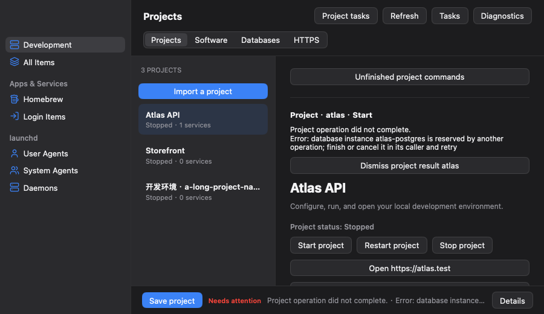

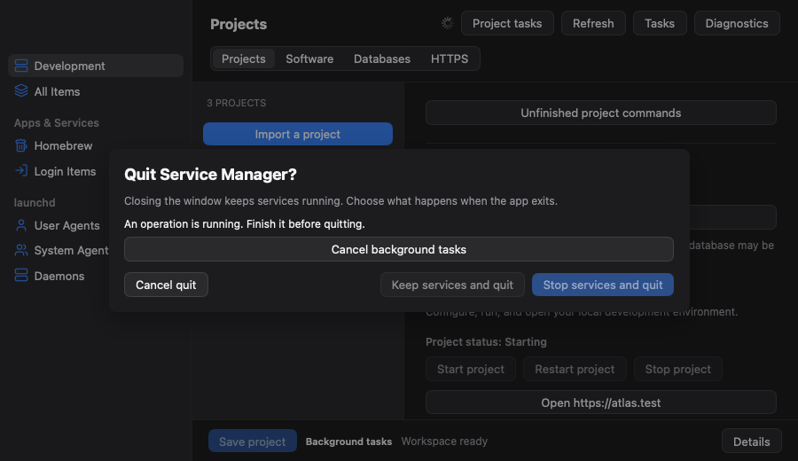

TestUIIndependentProjectsStartConcurrentlyKeepDraftsAndLatestHTTPS 在最小明暗窗口通过 UI 导入并配置两个实际服务，同时保持 HTTP 503 就绪等待；另行导入和保存独立项目，观察异步轮询不覆盖阶段，保留未保存草稿，并在等待期间配置独立 HTTPS 站点。分别验证单独取消、退出前取消全部项目再重试，最终通过新站点的真实隔离 CA TLS 请求返回 Beta。TestUIProjectCompletionRefreshesWithoutAnotherMainViewFrame 只处理 UI 回调而不继续渲染主视图，仍能更新启动/停止结果；这是 UI 引擎验证，不等于锁屏下已实际操作原生窗口或菜单栏。

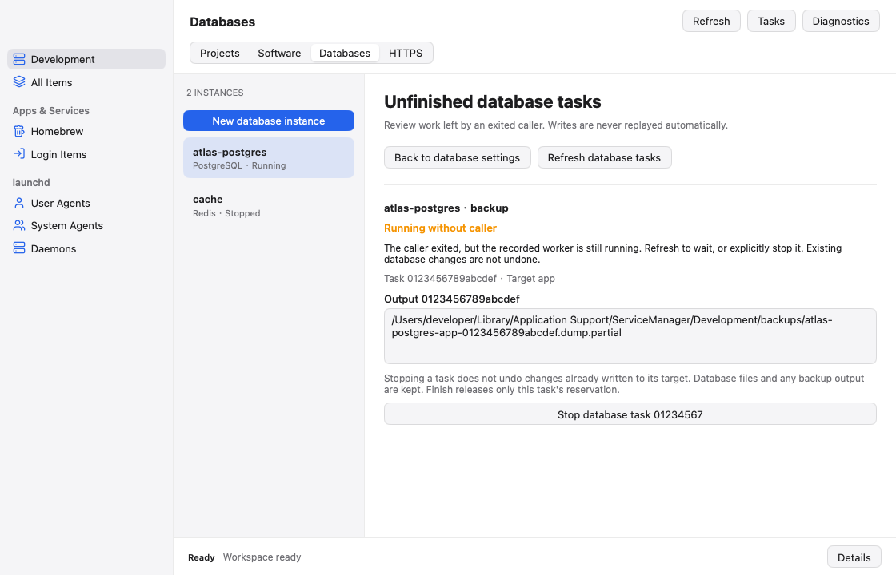

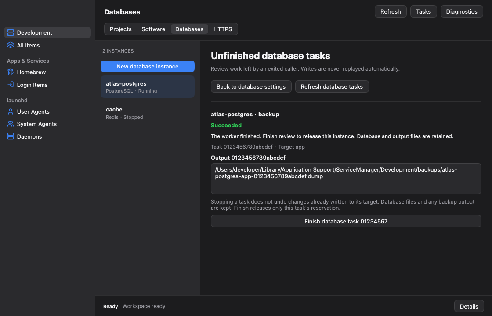

Unfinished database tasks 使用独立详情页，保留实例列表和返回入口。显示调用者/worker 的真实状态、目标和备份路径；运行中明确提示停止不撤销写入，完成后使用 Finish。归属不明或调用者仍占用时禁用收尾。长路径换行且只读，详情滚动可到达动作。选择其他实例或新建实例会离开审阅页。

新增 UI E2E 在 900×520 明暗窗口中让真实调用子进程退出，保留实际 Redis worker，随后经界面刷新、Finish、恢复备份并读出 42。原调用历史保持 Interrupted，不能由后续审阅伪造为成功。控制层另验证运行中中断、单独停止自有 worker 及其工具子进程、归属变更拒绝、旧审阅拒绝和私有凭据清理。


新增原生验收从最终通用 App 实际进入数据库任务审阅页，并通过 ⌘Q → Keep services and quit 退出；重新打开后的原生新进程读取原项目并显示 Healthy。随后从 App 打开实际 HTTPS，Chrome 重载显示 PHP 8.5.12。没有新授权、停止原服务或执行注销/登录；原生退出与重开现在有实机证据，登录事件仍待验收。

本机原生授权验收现已补齐：独立 arm64 App 准备、信任、激活临时 CA；真实 Node/Redis 项目通过系统 TLS，Chrome 页面和原生安全弹窗均通过。当前浏览器范围按用户要求仅 Chrome。独立 App 原生 Stop services and quit 关闭测试服务，重开后实际加载保存的 RunAtLoad agent，Redis 值 84 保留。原生和命令行收尾确认临时 CA 已移除、原 CA 保留。清理发现的“信任设置已不存在”恢复路径已修复，最小明暗窗口 UI E2E 验证可继续精确删除证书。

项目依赖安装现在使用 Project tasks 的后台进度和单独取消入口。Projects → Unfinished project commands 显示调用者仍在、调用者退出而 worker 运行、完成待审阅及归属异常四种状态。审阅页隐藏无关的 Save project，停止/完成按钮放在私有文件查看入口之前，最小窗口可到达；选择其他项目会退出审阅页。结果使用只读文本框，最多展示末尾 16 KiB，并保留 UTF-8 字符边界。

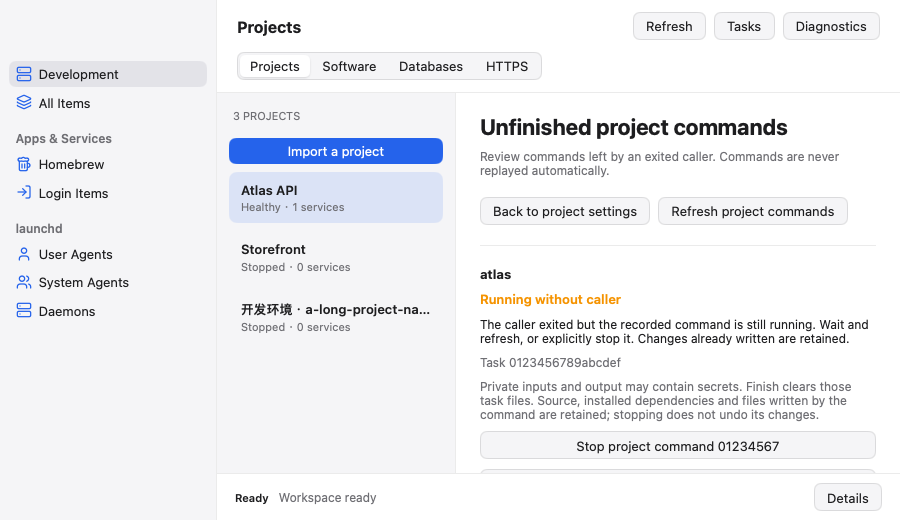

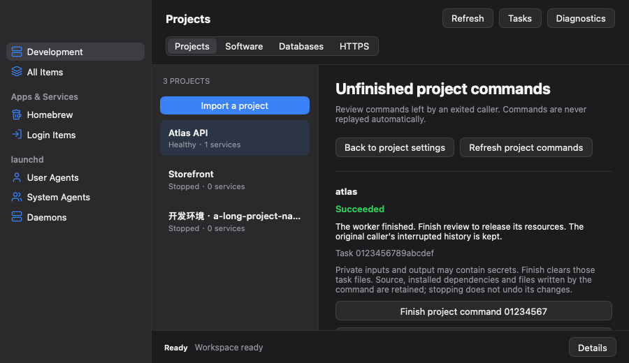

新增五个固定示例视图包含后台安装和四种审阅状态，共新增 20 张截图。UI E2E 验证最小明暗窗口的安装、独立项目保存与草稿保持、取消/重试、真实调用者退出后的停止/完成、归属变更禁用、私有目录交接和大 Unicode 输出。真实 npm 用例使用受管 Node 22.14.0，通过离线 npm ci 执行本地 postinstall，取消后确认实际脚本进程退出，再重试成功。
